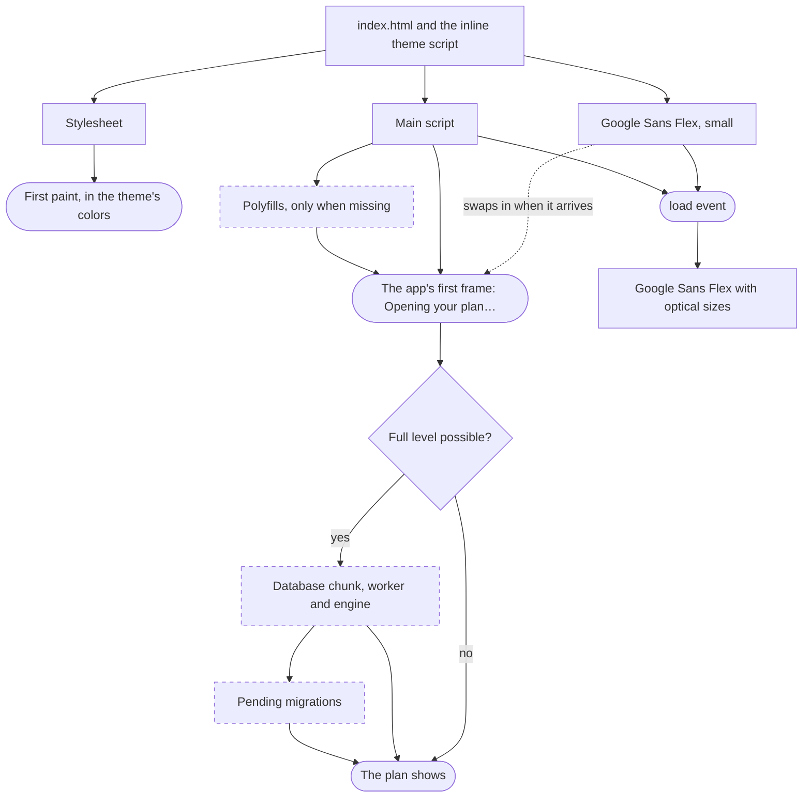

# Loading priorities

What the page loads, in which order, and why. Every resource the app adds gets a place in one of the tiers below. Add it here when you add it, and check the build output (`pnpm build`) to confirm it landed where this file says.

Sizes are from `pnpm build` of the full stack on 2026-10-17. Brackets give the gzipped size where the build reports one.

## Principles

- **The first paint needs only the HTML, the stylesheet, the main script and the small font.** Nothing else may block it.
- **Large or optional code is a dynamic `import()`.** Vite gives each one its own chunk, so it's only downloaded when it's needed.
- **Polyfills load only after feature detection says they're needed**, and never in the initial bundle (see [`docs/spec/browser-support.md`](spec/browser-support.md)).
- **Assets go through Vite**, which gives them a content hash and the base path, so a changed file is never served stale from a cache. A hash only changes when the file's contents change. Only files that need a fixed URL live in [`public/`](../public/): the service worker and `_headers`.
- **Show something while the slow part loads.** Storage can take a while on a first visit, so the app shows "Opening your plan…" instead of waiting with a blank page.

## Tiers

| Tier | What | Size | How it's loaded | Why there |
| --- | --- | --- | --- | --- |
| 1. Blocking | [`index.html`](../index.html), with the inline theme script | 2.8 KB (1.2 KB) | The navigation | The theme script must run before the first paint, or the page flashes in the wrong theme. It's kept tiny and runs right after `<meta name="color-scheme">`. |
| 1. Blocking | The stylesheet (`index-*.css`) | 0.3 KB, growing with the tokens and shapes | `<link rel="stylesheet">` added by Vite | CSS blocks rendering by nature. It holds the `@font-face` today, and the tokens and the 35 shapes once the UI imports them, so watch its size. |
| 2. High | The main script (`index-*.js`) | 35.7 KB (14.3 KB) | `<script type="module">` | Renders the app. It includes Solid, the plan logic, the localStorage and memory stores and the example week. In phase 4 it will also carry the icon sprite (3.9 KB gzipped), so icons render with the first frame. |
| 2. High | The shared `.json` file chunk (`json-file-*.js`) | 3.7 KB (1.7 KB) | `<link rel="modulepreload">` added by Vite | Used by the main script and the database chunk, so Vite splits it out and preloads it. |
| 2. High | Google Sans Flex, Latin, weights 400 to 700 | 36 KB | `<link rel="preload" as="font" crossorigin>` in [`index.html`](../index.html), `@font-face` in [`src/font/font.css`](../src/font/font.css) | Text is visible from the start. It shows in a fallback font with the same x-height (`font-size-adjust: from-font`) until this arrives, then swaps (`font-display: swap`). |
| 3. On demand | The database chunk (`database-*.js`), its worker (`worker-*.js`) and the Turso WebAssembly engine | 295 KB (73 KB), 171 KB, 11.6 MB (4.0 MB) | Dynamic `import("./database")` in [`src/storage/index.ts`](../src/storage/index.ts), only when the page is cross-origin isolated and OPFS and Web Locks exist | The biggest download by far, and only useful at the full storage level. Private windows and browsers without isolation never load it (see Progressive enhancement in [`docs/spec/persistence.md`](spec/persistence.md)). |
| 3. On demand | Migrations (`migration-*.js`, one per migration), Drizzle's migrator (`wasm-migrator-*.js`, `driver-core-*.js`) | 0.3 KB each, 1.1 KB (gzipped) | Dynamic `import()` in [`src/database/migration.ts`](../src/database/migration.ts), only for migrations the database doesn't have yet | A database that's up to date loads none of them, so old migrations never cost a download (see Drizzle in [`docs/spec/persistence.md`](spec/persistence.md)). A new database or an upgrade loads what it needs. |
| 4. After load | Google Sans Flex with the optical size axis | 85 KB | `new FontFace(…)` in [`src/font/index.ts`](../src/font/index.ts), after the `load` event | Better letterforms at every size, but not worth delaying the first paint. Replaces the small copy when it arrives. |
| 5. Only when missing | `temporal-polyfill` | 59 KB (20 KB) | Dynamic `import()` in [`src/polyfill/index.ts`](../src/polyfill/index.ts) when `globalThis.Temporal` is missing, awaited before the app renders | The app's dates and times need it from the first frame, so in Safari and older Chrome and Firefox it delays the first render by one small download. Browsers with Temporal never fetch it. |
| 5. Only when missing | `@formatjs/intl-durationformat` | 76 KB (18 KB) | The same, when `Intl.DurationFormat` is missing | Lengths are formatted from the first frame. Only Chrome before 129 and Firefox before 136 need it. Loaded in parallel with Temporal's. |
| 5. Only when missing | core-js's iterator helpers (`core-js/es/iterator`) | 32 KB (11 KB) | The same, when `Iterator.prototype.toArray` is missing | The plan logic chains iterators from the first frame (see Iterators in [`docs/guidelines/typescript.md`](guidelines/typescript.md)). Only Chrome before 122, Firefox before 131 and Safari before 18.4 need it. Loaded in parallel with the others. |
| 5. Only when missing | core-js's disposal symbols and stacks ([`src/polyfill/disposal.ts`](../src/polyfill/disposal.ts)) | 18 KB (7 KB) | The same, when `AsyncDisposableStack` is missing (Safari today) | The import check releases its database copy with `await using` (see "Clean up with `using`" in [`docs/guidelines/principles.md`](guidelines/principles.md)). |
| 5. Only when missing | `@oddbird/popover-polyfill` | | Dynamic `import()` when `"popover" in HTMLElement.prototype` is false | Planned for phase 4, with the menus, the placing toolbar and snackbars. |
| 5. Only when missing | `@oddbird/css-anchor-positioning` | | Dynamic `import()` when `"anchorName" in document.documentElement.style` is false | Planned for phase 4, with the add-block menu. |
| 6. Background | The service worker (`service-worker.js`) | | Registered by the inline script in [`index.html`](../index.html), only when the page isn't cross-origin isolated | It adds the isolation headers GitHub Pages can't send. The app never waits for it. |

## What waits for what

Solid arrows are waits: the step can't start until the one before it is done. Dashed boxes load only on some visits.

## A first visit on GitHub Pages

1. The HTML arrives. The theme script sets the color scheme, and the font preload starts.
2. The page isn't cross-origin isolated yet, so the inline script registers the service worker.
3. The stylesheet and the main script load. A browser without Temporal or `Intl.DurationFormat` fetches those polyfills first. Then the app shows "Opening your plan…". Without isolation it opens the limited storage level at first.
4. The service worker takes control, and the page reloads once, now isolated.
5. The app loads the database chunk, its worker and the WebAssembly engine, runs the migrations and shows the plan.
6. After the `load` event, the optical-size font replaces the small one.

On later visits the service worker is already in control, so the page is isolated from the first request. Every hashed file comes from the HTTP cache unless its contents changed.

## To watch

- **The WebAssembly engine is about 4 MB gzipped**, which makes it the slowest part of a first visit at the full level. Once the UI exists, measure whether starting its download earlier helps, for example a `modulepreload` of the database chunk when the page is already isolated.
- **The example week is in the main script** but is only needed on a first run. If the main script grows, it could become a dynamic import.
- **The stylesheet will grow** when the UI imports the tokens and the 35 shapes, which are 55 KB before compression. Measure it then, since everything in it blocks the first paint.
