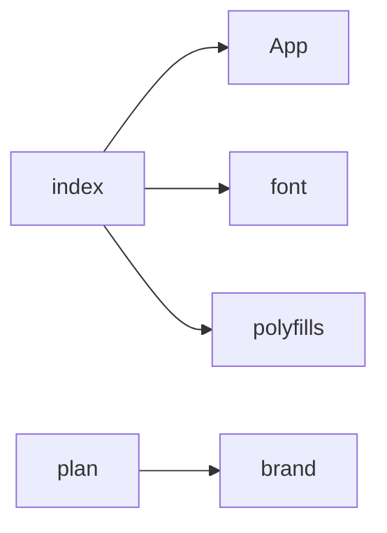

<!-- Generated by scripts/build-module-graph.ts. Don't edit by hand: run `pnpm modules`. -->

# Modules

Which of the app's modules in [`src/`](../src/) import which. A module is a folder directly in `src/` or a file directly in it. An arrow points from the importer to what it imports, and a dashed arrow is a dynamic `import()`, which loads only when it's needed (see [`docs/LOADING.md`](LOADING.md)).

Dependencies go one way (see Coupling in [`docs/guidelines/principles.md`](guidelines/principles.md)), so the graph has no cycles, and a test fails when one appears. The same test fails when this file is out of date: run `pnpm modules` after changing imports between modules.

