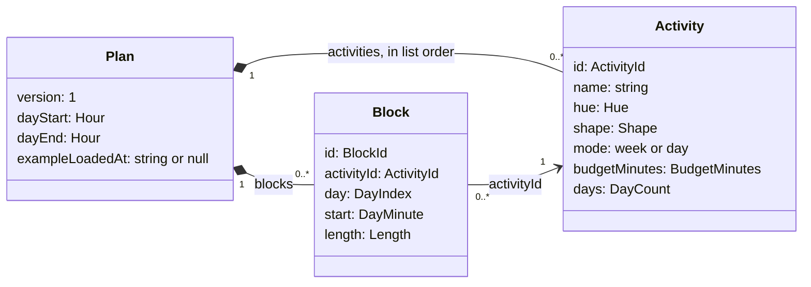
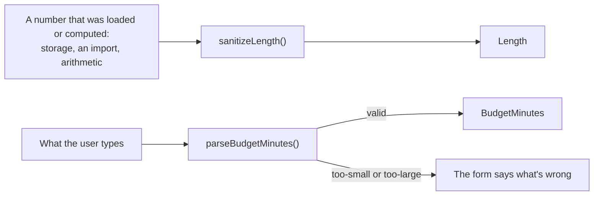

# Data model

One plan document per user. The stored shape is the same as [`examples/example-week.json`](../../examples/example-week.json):

```ts
type Plan = {
  version: 1;
  activities: Activity[];
  blocks: Block[];        // the blocks on the week
  dayStart: number;       // first of the day hours, 0..12 (default 7)
  dayEnd: number;         // end of the day hours, 13..24 (default 22)
  exampleLoadedAt: string | null; // when the example week was loaded (ISO 8601, UTC); null once it's kept or replaced
};

type Activity = {
  id: string;
  name: string;           // at most 60 characters
  hue: number;            // one of the 8 palette hues, see design.md
  shape: string;          // one of the 35 Material shape names, for example "heart", see design.md
  mode: "week" | "day";   // how the budget is counted
  budgetMinutes: number;  // budget in minutes, per week or per day; multiple of 15, at least 15
  days: number;           // 1..7, used only when mode === "day"
};

type Block = {
  id: string;
  activityId: string;     // Activity.id
  day: number;            // 0 = Monday … 6 = Sunday
  start: number;          // minutes from midnight, multiple of 15, 0..1425
  length: number;         // length in minutes, multiple of 15, 15..1440; start + length may pass 1440 (overnight block)
};
```

How the three relate, with the branded types the code gives each field (see below):



A plan owns its activities and blocks, and every block belongs to exactly one activity of the same plan. Removing an activity removes its blocks.

Ids are made with [nanoid](https://github.com/ai/nanoid)'s `customAlphabet`: 12 characters from `6789BCDFGHJKLMNPQRTWbcdfghjkmnpqrtwz`, which is `nolookalikesSafe` from `nanoid-dictionary`. It leaves out characters that look alike (1, l and I, 0 and O, and others) and vowels, so ids are easy to read back from a URL and never spell words. 36¹² is about 4.7 × 10¹⁸ (62 bits), plenty for one plan. nanoid draws its randomness from `crypto.getRandomValues()`, which, unlike `crypto.randomUUID()`, also works outside secure contexts. Ids are stored as text. A 12-character id is a third of a UUID string, and Turso's binary `uuid4()` wouldn't help, since ids are made in the browser and appear in URLs and files as text. Ids that come from storage, an import or the example week are kept as they are, as long as they are non-empty and at most 40 characters.

Time is stored as integer minutes and everything snaps to 15 minutes. Weekly budget: `calculateWeeklyBudget(activity) = activity.mode === "day" ? activity.budgetMinutes * activity.days : activity.budgetMinutes`. Placed: the sum of `length` over that activity's blocks. Left to place: `weekly budget − placed`. It can go negative, which means over budget.

A block covers the week minutes `[day * 1440 + start, day * 1440 + start + length)`, taken modulo 10080 (one week), so a block that starts on Sunday evening continues on Monday. Placed, left to place, overlaps and lanes, the first free slot and the per-day totals all work on these week minutes. A day's total counts only the part of each block that falls on that day.

Sanitize every loaded plan (from storage or sync): give activities with a missing or unknown `shape` their default shape (see [Design](design.md)), going through them in list order, clamp numbers, snap to 15, clamp `start` to 0..1425 and `length` to 15..1440 (the prototype's `sanitize()` instead clamped blocks to end by midnight; don't), give invalid or repeated ids new ones (blocks stay with the first activity that had their stored id), drop blocks whose activity no longer exists, and turn an `exampleLoadedAt` that isn't a valid date into null. The prototype's `sanitize()` is the reference.

**Checked values are branded types.** Every value above that has rules is its own type in the code, not a plain `number` or `string`: `ActivityId`, `BlockId`, `DayIndex` (0 is Monday, 6 is Sunday; Temporal's `dayOfWeek` is 1 to 7), `DayMinute` (a block's start), `WeekMinute` (a start on the whole week, for overlaps and slots), `Length`, `BudgetMinutes`, `DayCount` and `Hour` (the day hours). A hue or a shape is one of the listed values, as a literal type. Only a value's own sanitizer makes one, so a branded value is always valid, and the compiler keeps, for example, minutes of a day apart from minutes of the week. Each has two ways in:

- **A sanitizer** for data that was loaded or computed: it takes any number and returns the nearest valid value, as described above. `sanitizePlan` is made of them.
- **A strict parser** for what the user types or picks: it rejects a value out of range instead of clamping it, so the form can say what's wrong (see Activities in [Interactions](interactions.md)).



The database checks the same rules again with `CHECK` constraints on its columns (see Suggested tables in [Persistence](persistence.md)), so nothing that skipped the types can be stored.

The theme choice is a device preference, not part of the plan. It isn't in the database or in exports: it lives in `localStorage` under `week-budget-planner.color-scheme`. The stored value is the CSS `color-scheme` value it stands for, `light` or `dark`, and System, which is `light dark`, removes the entry. It has to be readable before the first paint, which the database isn't (see Theme in [Design](design.md)). The copy calls it the theme; the code calls it the color scheme, after the CSS property (see Names in [`docs/guidelines/principles.md`](../guidelines/principles.md)). Contrast and Motion are device preferences in the same way: `week-budget-planner.contrast` holds `more`, `less` or `standard`, and `week-budget-planner.motion` holds `reduced` or `full`. System removes the entry, so the browser setting applies again. Each is read before the first paint, by the inline script that also applies the theme.
