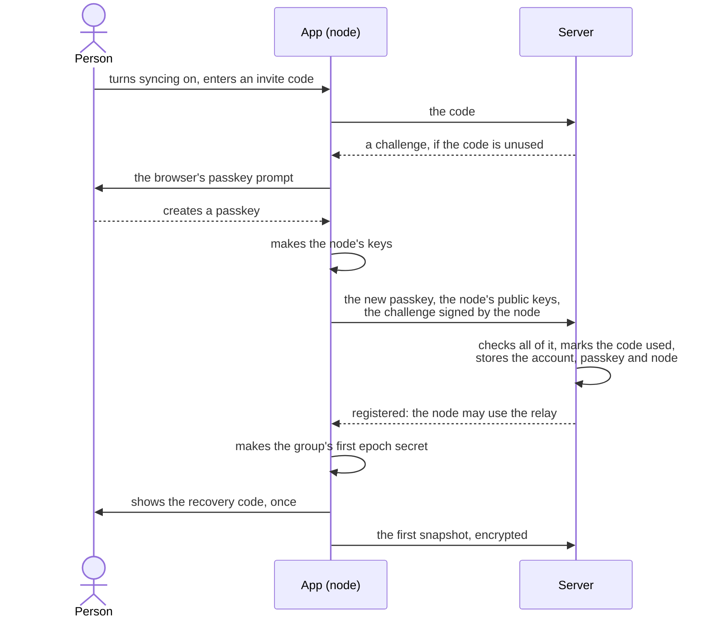
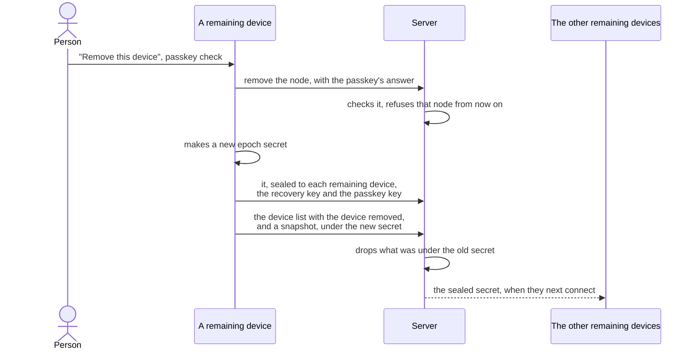

# Identity, sign-in and groups

**Phase 3 of [Network](network.md), table service, designed and not built yet.** What an account and a server add to [self-service](self-service.md): how a person signs in, the group's key for what the mailbox stores, and ways into the group that need no second device at hand. The group itself, its device list, and adding and removing a device with a code are in [Self-service](self-service.md), and need no account. How changes travel to the mailbox is in [The sync protocol](sync.md). The work was [SantaClaas/week-budget-planner#91](https://github.com/SantaClaas/week-budget-planner/issues/91), reshaped by [SantaClaas/week-budget-planner#105](https://github.com/SantaClaas/week-budget-planner/issues/105).

## What the cryptography is for

**The reasons are one chain, not a ranking.** It starts with the person who runs the server and ends with the people who use it:

1. **Whoever runs the server can't carry other people's data.** Holding plans, names or email addresses means answering for them: keeping them safe, handing them out on request, deleting them properly. The operator has neither the means to have that verified nor the wish for that weight.
2. **So the server is built to hold nothing it can read.** What it stores is bytes it can't open and keys it can't use, and it knows a person by a random id.
3. **Being free of that weight is what makes it possible to offer the service at all.** One that couldn't be run responsibly would help nobody. It's the oxygen mask rule: help yourself first, so that you're able to help others.
4. **And the same property is what the people using it get.** A plan that lives on the devices of the person it belongs to, and that a server can only carry and never read, stays in that person's hands: they can see all of it, take it elsewhere and delete it, without asking anyone. That is the self-determination that data protection is there to protect. Germany's constitutional court named it in 1983 (*informationelle Selbstbestimmung*), and argued that a free, democratic society needs it, since people who can't know what is known about them stop acting freely. Local-first design and encryption build that in, where a policy could only promise it.

So what protects the operator and what serves the people using the service is the same decision, seen from two sides. That is sturdier than good intentions alone: it doesn't depend on anyone staying willing to carry a burden.

**The bound: helping yourself is the means, and never at the others' expense.** The chain only holds while step 1 leads to step 4. A choice that eases the operator's load by moving a cost onto the people using the service breaks it, and this line is harder to draw than the rest. Two questions help to find it:

- **Can the people it falls on see the cost, and say no to it?** A limit that is stated plainly, before someone relies on the service, leaves the choice with them. One they'd only find out about afterwards doesn't.
- **Would they choose it too, if they stood where the operator stands?** Not keeping their data readable: yes. Keeping more of it because that's easier to run: no.

Where this design already sits on that line, and how it stays on the right side:

- **The cryptography has not been reviewed.** That is the operator's limit, and the risk of a flaw falls on the users. So it is said plainly, and the app must not promise more than is true: it can say that the server can't read the plan by design, and not that the design was audited. This is a design by people who build apps, not by cryptographers. It only combines standard, published constructions and says which, so that it can be checked later.
- **The storage limit and the leases** (see [The sync protocol](sync.md)) save the operator cost. They never cost a user their plan, since every device keeps all of it, and the app warns before anything on the server is deleted.
- **What the server still learns** (see [What the server learns](network.md#what-the-server-learns) in [Network](network.md)) is written down, not left out, including what isn't solved.

What would cross it: a disclaimer used where the design could have removed the risk, logs kept because they're convenient, or a cheaper way to run the server that lets someone else see more.

Where this file says "to check", a fact about browsers or libraries has to be confirmed against its source when it's built.

**The lack of a review has to be covered where promises are made.** Two places, and they aren't the same:

- **The code's license** says the software comes without warranty and limits liability for it. The repository has none yet, and needs one before this is built.
- **The service's terms.** A license covers people who take the code. People who use the server the operator runs are covered by that service's terms and its privacy notice, which say what it stores, that it can't read plans by design, that this wasn't audited, and that it comes as it is. They are part of deciding where the server runs ([SantaClaas/week-budget-planner#95](https://github.com/SantaClaas/week-budget-planner/issues/95)). How far liability can be excluded depends on the operator's country, and is a question for someone who knows its law. A disclaimer is the last resort, for what the design couldn't remove (see the bound above).

## Decided

Rules about what the person gets, or choices that are the project's author's.

1. **Table service needs an account:** an invite code and a passkey. Self-service needs neither (see [The account](#the-account)).
2. **"Any device with my passkey can open my week" is offered as a choice** when table service is set up (see [The passkey shortcut](#the-passkey-shortcut)). It makes adding a device and recovery easy, and it means the plan is as safe as the passkey, and no safer.
3. **A recovery code is shown once** when table service is set up (see [Losing everything](#losing-everything)).
4. **What touches the account or the server's data needs a passkey check:** removing a device from the mailbox, turning the passkey shortcut on, and deleting the server's data. Syncing itself never asks (see [Signing in](#signing-in)).
5. **The passkeys belong to the app's exact address,** not to the whole domain (see [The domain](#the-domain)).
6. **Keeping the passkey's record inside the passkey is not built now** (see [What isn't adopted](#what-isnt-adopted)).
7. **A person is known to the server by nothing personal:** no email address and no name (see [The account](#the-account)).
8. **A device can also be added without a second one present:** approved later by a device that's in, or by the passkey alone (see [Adding a device](#adding-a-device)).

## Who is who

| | What it is | Proves |
| --- | --- | --- |
| **Account** | what the server knows a person by: a random id, their passkeys and their group | nothing by itself |
| **Passkey** | the person's credential, kept by their device or password manager | that the person is there and agrees, with user verification |
| **Node** | one browser on one device, with its own keys (see [Terms](network.md#terms) in [Network](network.md)) | that a message comes from that device |
| **Group** | the nodes that share the plan. It exists without an account, in self-service; table service gives it a key for what the mailbox stores | by being on the device list, that a node was let in by another |

**The passkey is the person's authority, and the node's key is the device's.** A passkey check lets a device in and approves what could lock the person out. After that, the device's own key is what the server and the relay recognise, so syncing never prompts.

## Keys

| Key | Kind | Made | Kept | For |
| --- | --- | --- | --- | --- |
| **Node signing key** | Ed25519 | on the device, the first time syncing is set up | on the device, wrapped (see below) | the node's id on the transport: it is the iroh endpoint key ([SantaClaas/week-budget-planner#80](https://github.com/SantaClaas/week-budget-planner/issues/80)) |
| **Node encryption key** | X25519 | with it | the same | receiving the group's secret |
| **Epoch secret** | 32 random bytes | by the device that turns table service on, and again by the one that removes a device | on each member, wrapped | encrypting changes and snapshots; "the group key" |
| **Storage key** | AES-256-GCM, not extractable | on the device | in IndexedDB, as a key the page can use and not read | wrapping the three above where they're stored |
| **Recovery key** | X25519, its private half derived from the recovery code | when the group is created | the public half in the group; the private half only as the code the person keeps | opening the group when no device is left |
| **Passkey key** | X25519, its private half derived from the passkey's PRF output | when the shortcut is turned on | the public half in the group; the private half nowhere | the passkey shortcut |

- **The cryptography runs in the Rust module** that holds the transport, with maintained crates, not in code of our own and not spread over the Web Crypto API. The constructions are the ones MLS uses in its ciphersuite with X25519, so the later move to MLS changes who manages the keys and not the mathematics: HPKE ([RFC 9180](https://www.rfc-editor.org/rfc/rfc9180)) with X25519, HKDF-SHA256 and ChaCha20-Poly1305 for sealing a secret to a public key, the same AEAD for messages, and Ed25519 for signatures.
- **Keys are not in the SQLite database,** so an export never contains one, and an import never brings one.
- **Wrapped where they're stored:** the secret keys are encrypted with the storage key, which the browser holds as a key that can be used and not read. A copy of the stored bytes alone is then useless. A script running in the page could still use them while it runs, which is what the Content Security Policy and Trusted Types are there to prevent (see [Security](security.md)).
- **The node id in a stamp is not a key.** It stays the short random id of [Merging changes](merge.md), and changes on an import. Every member holds the same epoch secret, so any member could write any stamp anyway: inside a group of one person's devices, nothing is signed per device. Sharing a plan with other people needs that, and MLS brings it.
- **Clearing the browser's data removes the keys with the plan.** The device is then new, and joins again.
- **A window that keeps nothing** holds its keys in memory only.

## The account

- **The server knows an account by a random id.** It asks for no email address and no name. The passkey has to carry a label for the person's password manager, which the app sets to its own name and the date ("Week Budget Planner, 15 November 2026"), editable there.
- **What the server stores per account:** the id, when it was made, whether it's blocked, its passkeys, its nodes and its group.
- **Per passkey:** the credential's id, its public key, its signature counter, when it was added, and whether it has the PRF extension. Nothing a passkey could be used with elsewhere.
- **Per node:** its two public keys, whether it's temporary, when it was last seen, and whether it was removed.

### Invite codes

- **A code works once.** It is 128 random bits, shown as text in groups of letters and digits, made by the operator with a command on the server.
- **The server stores each code's hash,** when it expires and what used it, so a copy of the server's data holds no code that still works.
- **Registering takes a code** and nothing else does. Attempts are limited per address.

## Signing in

Registration and sign-in are ordinary requests to the app's own origin. They can't go over the transport, since the relay only admits nodes it already knows.

- **WebAuthn as specified, checked by a maintained library** on the server, never by hand: a fresh challenge per attempt that works once and expires in minutes, the origin and the RP ID checked, user verification required, discoverable credentials so nothing has to be typed.
- **The node signs the challenge too,** which proves it holds the key it registers.
- **Signing in on another device** is the same without the invite code: a passkey check, and the node is on the account. A device that is already in the group, by self-service, then needs only the group's secret, which another device gives it or the mailbox holds sealed for it. One that isn't in the group yet is added as in [Adding a device](#adding-a-device).
- **After that, the node's key is the sign-in.** The transport proves it on every connection, and the server checks it against the account's nodes. There is no session to expire and no token to keep.
- **A passkey check is asked again** only for what could lock the person out or can't be undone: adding a device, removing one, turning the passkey shortcut on, and deleting the server's data. The server requires it and checks it.
- **Ask before the browser asks:** the passkey prompt comes after the app has said what it's for, on a button (see [Browser permissions](security.md#browser-permissions) in [Security](security.md)).

## Encrypting changes and snapshots

- **A key per message.** Each change or snapshot gets 32 random bytes of its own, sent with it in the clear, and its key is derived from the epoch secret and those bytes with HKDF-SHA256. A key used once can't repeat a nonce, so the cipher's nonce is fixed.
- **ChaCha20-Poly1305** encrypts it, with the protocol version, the group, the key epoch and the kind (change or snapshot) as associated data, so it only decrypts as what it was sent as (see [The envelope](sync.md#the-envelope) in [The sync protocol](sync.md)).
- **Anything that doesn't decrypt is refused,** as a value the app can report, and nothing of it is merged.

## The group's device list

**Who is in the group is written inside the group,** as rows that sync like the plan's (see [The device list](self-service.md#the-device-list) in [Self-service](self-service.md)). With the mailbox, those rows are encrypted like everything else it's given.

**Why it can't be the server's list.** A device that hands out the epoch secret seals it to the keys of the group's members. If it took those keys from the server, a server that added a key of its own would be sent the secret. The server keeps a list too, of node ids, to decide who may connect; nothing secret is ever sent on the strength of it.

## Adding a device

**A device is added with a code, between the two devices, as in self-service** (see [Adding a device](self-service.md#adding-a-device) in [Self-service](self-service.md)). No account and no server take part. Table service adds two things to it, and two more ways in.

- **The group's secret goes with it.** When a device is let in, the device that lets it in gives it the epoch secret over their connection, and tells the server the new node belongs to the group (see [What the identity design adds](sync.md#what-the-identity-design-adds) in [The sync protocol](sync.md)).
- **Where the new device has the passkey, it signs in with it,** which puts it on the account, so the mailbox serves it.
- **Why the device that's in shows the code and the new one reads it,** and not the other way round. If the trusted device scanned a code, an attacker could get someone to scan theirs, as has been done against messengers that link devices that way. Here the secret starts on the trusted device, and an attacker has to see its screen.
- **Two ways that need no second device at hand,** which only a server that keeps things makes possible: [approved later](#approved-later-by-a-device-thats-in), and [the passkey shortcut](#the-passkey-shortcut).

### Approved later, by a device that's in

**A new device can ask to join with the passkey alone, and be let in whenever one of the person's devices is next online.** No code, and the two devices needn't be present together.

1. The new device makes its keys and passes a passkey check whose challenge is made from those keys. The passkey's answer then says: the person holding this passkey vouches for these keys.
2. It leaves the answer with the mailbox, which keeps it for the group (see [What the identity design adds](sync.md#what-the-identity-design-adds) in [The sync protocol](sync.md)).
3. A device that's in checks the answer against the passkey's record, which the group keeps in its own data (see [What isn't adopted](#what-isnt-adopted)), shows what is asking, and waits for the person to confirm.
4. It seals the epoch secret to the new device, and adds it to the device list.

- **Nobody in between can fake it.** The check is made by a device, against a record the group holds, so the server and the relay can't put their own keys in: they can't forge a passkey's answer.
- **It works with any passkey,** unlike [the passkey shortcut](#the-passkey-shortcut), which needs the PRF extension. And unlike the shortcut, the passkey alone doesn't open the plan: a device that's in still has to say yes.
- **What it costs:** the new device waits until another is online, and someone who has the passkey can ask. The person confirming has to recognise what is asking, so the prompt names the device and when it asked.
- **A request expires** after a few days, and a device shows at most a few at once.
- **A passkey's answer covers its challenge and nothing else,** so the challenge is a hash of the new device's two public keys, the group and a time. To check: that the verifying library accepts a challenge the verifier didn't issue itself, which is unusual, and what that means for replay. The time and the one-use device keys are what bound it.

### The passkey shortcut

Where the passkey has the PRF extension, the passkey itself can open the group, on any device the passkey is on, with no other device at hand.

- **How:** the passkey gives the same secret bytes on every device, only to this app, and only after user verification. A key pair is derived from them (HKDF-SHA256, then X25519). Its public half is in the group, and every epoch secret is sealed to it and kept by the server. A device that signs in with that passkey derives the private half, fetches the sealed secret and opens it.
- **It is a choice,** asked when syncing is set up and changeable later, because it changes what protects the plan. Without it, signing in gets a device nowhere until another device lets it in. With it, whoever controls the passkey, and so whoever gets into the account that syncs the person's passkeys, can read the plan.
- **It also recovers:** a person who lost every device still has the passkey.
- **Support, to check when it's built:** as of late 2026 the PRF extension is reported for passkeys in iCloud Keychain (iOS 18.4, macOS 15), Google Password Manager, and Windows Hello since an update in February 2026, and is uneven in other password managers ([Corbado's overview](https://www.corbado.com/blog/passkeys-prf-webauthn), [their tests of password managers](https://www.corbado.com/blog/webauthn-l3-credential-manager-support)). These are secondary sources that disagree in places. The app asks the browser what the passkey can do and only offers the shortcut where it works.
- **It is never the only way in.** A co-editor of WebAuthn [advises against](https://lilting.ch/en/articles/passkeys-prf-extension-encryption-risk) keys that exist only through PRF, since a lost passkey is then lost data. Here every device holds the whole plan, and pairing and the recovery code work without it.

## Removing a device

- **The server refuses the removed node at once,** on the relay and in the protocol. It answers "not a member", and the device turns syncing off and keeps the plan it has (see [What a node does when refused](sync.md#what-a-node-does-when-refused) in [The sync protocol](sync.md)).
- **The new secret is what really shuts it out.** It is sealed only to the devices that remain, so the removed device can read nothing written after, even if the server went on serving it.
- **What it already had, it keeps.** Removing a device can't take back a plan it has read.
- **The race, solved by the passkey check:** someone holding a stolen, unlocked device can't remove the person's other devices, because removing needs the passkey with user verification, which is a fingerprint, a face or the device's code. Someone who also knows the device's code has the passkeys too, and then has everything the person has. No design here stops that.
- **A temporary node that's let go** is taken off the list without a new secret (see [Removing a device](network.md#removing-a-device) in [Network](network.md)).

## Losing everything

- **The recovery code** is shown once, when the group is created: 128 random bits as text, to be written down or kept in a password manager. The private half of the recovery key is derived from it, the public half is in the group, and every epoch secret is sealed to it and kept by the server. With the passkey to sign in and the code to open the secret, a new device gets the group back.
- **No device keeps the code,** so a stolen device doesn't have it.
- **The passkey shortcut does the same** where it's on.
- **Without either, and with no device left,** what the server holds can't be read by anyone, and the plan is gone. The app says so plainly when the code is shown.
- **A lost passkey with devices left:** a device that's in can register a new passkey for the account, after a check with a remaining one. **The last passkey lost, with devices left:** the plan is still on them, and syncing is set up again with a new invite code. To check: whether the operator wants a way to attach a new passkey to an old account by hand.

## The domain

**A passkey belongs to an RP ID, which is a domain, and can't be moved to another.** It is a setting of the server, never a value in the code.

- **The RP ID is the app's exact address,** such as `planner.example.com`, not the registrable domain above it. Passkeys made for the whole domain could be used by any other site under it.
- **If the address ever changes,** Related Origin Requests let a new address use the old RP ID, through a list the old domain serves ([Allow passkey reuse across your sites](https://web.dev/articles/webauthn-related-origin-requests)). It is in current browsers, with at most five addresses, to check when needed. The browser's stored plan doesn't follow; an export and an import carry it.
- **The relay's address and the server's node id** come from the same setting, and the app gets them from the server.

## Who can do what

| | Read the plan | Change the plan | Stop syncing | Lock the person out |
| --- | --- | --- | --- | --- |
| **The server, curious** | no | no | yes | no |
| **The server, taken over** | not from what it stores. Yes, by serving changed app code (see [What the server learns](network.md#what-the-server-learns) in [Network](network.md)) | the same | yes, and it can delete what it holds; the devices keep the plan | from syncing, not from the plan on a device |
| **The relay** (part of the server) | no | no | yes | no |
| **Someone on the network** | no: TLS, then the transport's own encryption, then the group's | no | by blocking the connection | no |
| **Someone with a stolen device, locked** | no, as far as the device's own lock holds | no | no | no |
| **The same, unlocked, without its code** | yes, what's on it, and what syncs until it's removed | yes, until it's removed | no | no: removing needs a passkey check |
| **The same, with its code** | yes | yes | yes | yes |
| **Someone with an old export** | yes, that plan; it holds no keys | no | no | no |
| **Someone who saw the pairing code** | only if they use it within ten minutes, before the person does, and the person confirms their device; never where the new device passes a passkey check | then yes, until removed | no | no: removing needs a passkey check |
| **Someone in the account that syncs the passkeys** | only with the passkey shortcut on | then yes | yes, by removing devices | yes |
| **A removed device** | what it had | no | no | no |

**What the server learns** about people is in [Network](network.md) and [The sync protocol](sync.md). This design adds: how many passkeys and devices an account has, when each device was added and removed, and whether the passkey shortcut is on.

## What MLS replaces later

- **Replaced:** the epoch secret and how a new one reaches each device, the sealed copies the server keeps, and the device list as the proof of who is in. MLS does all of that, with forward secrecy and a signature per member.
- **Stays:** accounts, invite codes, passkeys and their checks, the pairing code as the way a new device's keys are trusted, the recovery code, the passkey shortcut (as one more member of the group), and how changes are encrypted once a secret is agreed.

## What this adds to the sync protocol

The messages for pairing, for the sealed secrets, for removing a node and for starting a new epoch are in [What the identity design adds](sync.md#what-the-identity-design-adds) in [The sync protocol](sync.md).

## What isn't adopted

From [Ideas for the infrastructure](network.md#ideas-for-the-infrastructure) in [Network](network.md):

- **The passkey's record kept away from the server.** The idea: the server signs a passkey's record (its id and public key), the person's devices keep it, and a device sends it along with a passkey's answer. Two carriers were looked at:
  - **In the passkey itself** (`largeBlob`): only iCloud Keychain clearly supports it today, and Chrome's team has favored PRF over it ([Corbado's tests](https://www.corbado.com/blog/webauthn-l3-credential-manager-support)).
  - **In the group:** the records as rows in the group's encrypted data, beside the device list, handed to a new device when it joins. **This part is adopted,** since [approving a device later](#approved-later-by-a-device-thats-in) checks a passkey against it, and a group in self-service guards its device list with it (see [Who may change the group](self-service.md#who-may-change-the-group) in [Self-service](self-service.md)).
  - **Where neither reaches:** the passkey shortcut and recovery after losing every device, where a new device has the passkey and nothing else. For those the server has to keep the public key.
  - **Why not now:** both of those ways in are offered, so the server keeps the record anyway. It also keeps each account's nodes, removed passkeys and blocks regardless, and a public key isn't sensitive, so what would be saved is state, not exposure. A later version could keep the records in the group, and on the server only for accounts that turn the passkey shortcut on.
- **Signed leases the node carries.** The server holds each account's nodes to decide who may use the relay, so it looks them up and needs no token. A lease as a stored date is used for temporary nodes and for how long a group's data is kept (see [Leases](sync.md#leases) in [The sync protocol](sync.md)).

## What the person does

Only the steps; the screens are their own issue ([SantaClaas/week-budget-planner#99](https://github.com/SantaClaas/week-budget-planner/issues/99)).

- **Setting up table service:** read what it adds and what the server stores, enter an invite code, create a passkey, choose whether the passkey alone may open the week, write down the recovery code.
- **Adding a device:** as in self-service, with a code (see [What the person does](self-service.md#what-the-person-does) in [Self-service](self-service.md)). Or, with no second device at hand: sign in with the passkey on the new one, and confirm it on a device that's in whenever that one is next used; with the passkey shortcut on, signing in is enough.
- **Removing a device:** pick it in the list, pass the passkey check.
- **A private window:** sign in with the passkey, and the same as adding a device. It's listed as temporary and goes when it closes.
- **After losing every device:** sign in with the passkey on a new one, and enter the recovery code, or nothing with the passkey shortcut.
