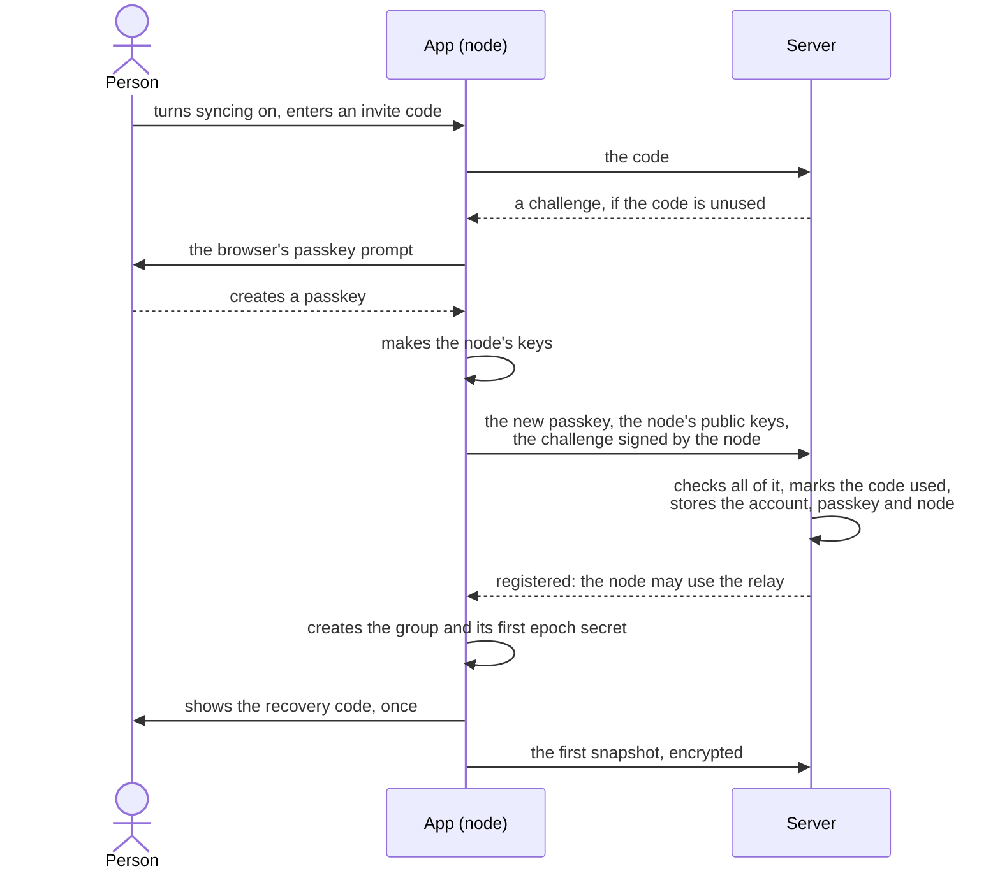
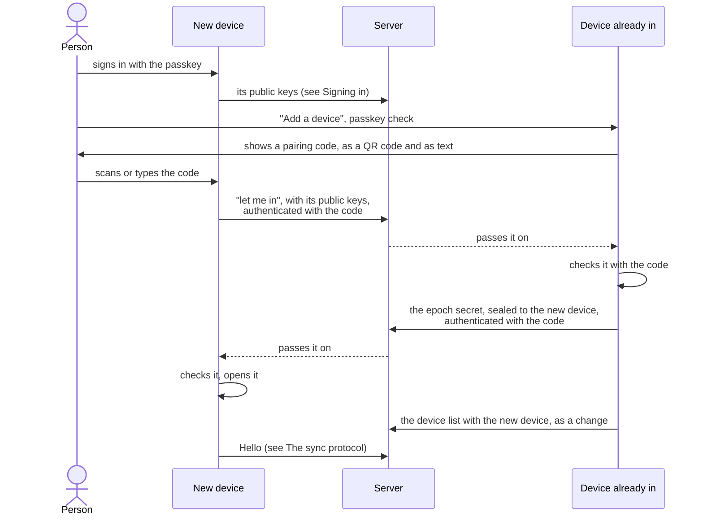
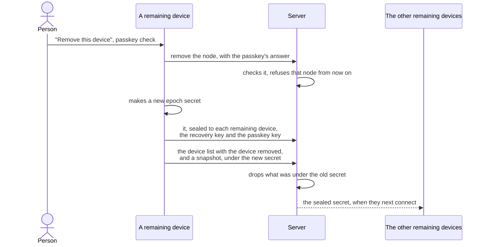

# Identity, sign-in and groups

**Phase 2 of [Network](network.md), designed and not built yet.** Who a node is, how a person signs in, how a group's devices come to share a key, and how one is removed. How changes travel once that's settled is in [The sync protocol](sync.md). The work is [SantaClaas/week-budget-planner#91](https://github.com/SantaClaas/week-budget-planner/issues/91).

## What the cryptography is for

**First, to keep people's data off the server,** so that whoever runs it holds nothing they'd be responsible for: no plan, no name, no email address. What the server stores is bytes it can't read, and keys it can't use.

**Second, and close behind, to be secure** against the others in the table under Who can do what.

**It has not been reviewed.** This is a design by people who build apps, not by cryptographers, and there are no means to have it verified for now. It only combines standard, published constructions and says which, so that it can be checked later. The app must not promise more than that: it can say that the server can't read the plan by design, and not that the design was audited. Where this file says "to check", a fact about browsers or libraries has to be confirmed against its source when it's built.

**The lack of a review has to be covered where promises are made.** Two places, and they aren't the same:

- **The code's license** says the software comes without warranty and limits liability for it. The repository has none yet, and needs one before this is built.
- **The service's terms.** A license covers people who take the code. People who use the server the owner runs are covered by that service's terms and its privacy notice, which say what it stores, that it can't read plans by design, that this wasn't audited, and that it comes as it is. They are part of deciding where the server runs ([SantaClaas/week-budget-planner#95](https://github.com/SantaClaas/week-budget-planner/issues/95)). How far liability can be excluded depends on the owner's country, and is a question for someone who knows its law.

## Decided

Rules about what the user gets, or choices that are the owner's.

1. **A new device is added with a pairing code** shown by a device that's already in, as a QR code and as text (see Adding a device).
2. **"Any device with my passkey can open my week" is offered as a choice** when syncing is set up (see The passkey shortcut). It makes adding a device and recovery easy, and it means the plan is as safe as the passkey, and no safer.
3. **A recovery code is shown once** when the group is created (see Losing everything).
4. **Removing a device, adding one and deleting the server's data each need a passkey check.** Syncing itself never asks (see Signing in).
5. **The passkeys belong to the app's exact address,** not to the whole domain (see The domain).
6. **Keeping the passkey's record inside the passkey is not built now** (see What isn't adopted).
7. **A person is known to the server by nothing personal:** no email address and no name (see The account).

## Who is who

| | What it is | Proves |
| --- | --- | --- |
| **Account** | what the server knows a person by: a random id, their passkeys and their group | nothing by itself |
| **Passkey** | the person's credential, kept by their device or password manager | that the person is there and agrees, with user verification |
| **Node** | one browser on one device, with its own keys (see Terms in [Network](network.md)) | that a message comes from that device |
| **Group** | the nodes that share the plan and the key to read it | by holding the key, that a node was let in by another |

**The passkey is the person's authority, and the node's key is the device's.** A passkey check lets a device in and approves what could lock the owner out. After that, the device's own key is what the server and the relay recognise, so syncing never prompts.

## Keys

| Key | Kind | Made | Kept | For |
| --- | --- | --- | --- | --- |
| **Node signing key** | Ed25519 | on the device, the first time syncing is set up | on the device, wrapped (see below) | the node's id on the transport: it is the iroh endpoint key ([SantaClaas/week-budget-planner#80](https://github.com/SantaClaas/week-budget-planner/issues/80)) |
| **Node encryption key** | X25519 | with it | the same | receiving the group's secret |
| **Epoch secret** | 32 random bytes | by the device that creates the group, and again by the one that removes a device | on each member, wrapped | encrypting changes and snapshots; "the group key" |
| **Storage key** | AES-256-GCM, not extractable | on the device | in IndexedDB, as a key the page can use and not read | wrapping the three above where they're stored |
| **Recovery key** | X25519, its private half derived from the recovery code | when the group is created | the public half in the group; the private half only as the code the person keeps | opening the group when no device is left |
| **Passkey key** | X25519, its private half derived from the passkey's PRF output | when the shortcut is turned on | the public half in the group; the private half nowhere | the passkey shortcut |

- **The cryptography runs in the Rust module** that holds the transport, with maintained crates, not in code of our own and not spread over the Web Crypto API. The constructions are the ones MLS uses in its ciphersuite with X25519, so the later move to MLS changes who manages the keys and not the mathematics: HPKE ([RFC 9180](https://www.rfc-editor.org/rfc/rfc9180)) with X25519, HKDF-SHA256 and ChaCha20-Poly1305 for sealing a secret to a public key, the same AEAD for messages, and Ed25519 for signatures.
- **Keys are not in the SQLite database,** so an export never contains one, and an import never brings one.
- **Wrapped where they're stored:** the secret keys are encrypted with the storage key, which the browser holds as a key that can be used and not read. A copy of the stored bytes alone is then useless. A script running in the page could still use them while it runs, which is what the Content Security Policy and Trusted Types are there to prevent (see [Security](security.md)).
- **The node id in a stamp is not a key.** It stays the short random id of [Merging changes](merge.md), and changes on an import. Every member holds the same epoch secret, so any member could write any stamp anyway: inside a group of one person's devices, nothing is signed per device. Sharing a plan with other people needs that, and MLS brings it.
- **Clearing the browser's data removes the keys with the plan.** The device is then new, and joins again.
- **A window that keeps nothing** holds its keys in memory only.

## The account

- **The server knows an account by a random id.** It asks for no email address and no name. The passkey has to carry a label for the person's password manager, which the app sets to its own name and the date ("Week Budget Planner, 15 November 2026"), editable there.
- **What the server stores per account:** the id, when it was made, whether it's blocked, its passkeys, its nodes and its group.
- **Per passkey:** the credential's id, its public key, its signature counter, when it was added, and whether it has the PRF extension. Nothing a passkey could be used with elsewhere.
- **Per node:** its two public keys, whether it's temporary, when it was last seen, and whether it was removed.

### Invite codes

- **A code works once.** It is 128 random bits, shown as text in groups of letters and digits, made by the owner with a command on the server.
- **The server stores each code's hash,** when it expires and what used it, so a copy of the server's data holds no code that still works.
- **Registering takes a code** and nothing else does. Attempts are limited per address.

## Signing in

Registration and sign-in are ordinary requests to the app's own origin. They can't go over the transport, since the relay only admits nodes it already knows.

- **WebAuthn as specified, checked by a maintained library** on the server, never by hand: a fresh challenge per attempt that works once and expires in minutes, the origin and the RP ID checked, user verification required, discoverable credentials so nothing has to be typed.
- **The node signs the challenge too,** which proves it holds the key it registers.
- **Signing in on another device** is the same without the invite code: a passkey check, and the new node is on the account. It can then reach the relay, and is waiting to be let into the group (see Adding a device).
- **After that, the node's key is the sign-in.** The transport proves it on every connection, and the server checks it against the account's nodes. There is no session to expire and no token to keep.
- **A passkey check is asked again** only for what could lock the owner out or can't be undone: adding a device, removing one, turning the passkey shortcut on, and deleting the server's data. The server requires it and checks it.
- **Ask before the browser asks:** the passkey prompt comes after the app has said what it's for, on a button (see Browser permissions in [Security](security.md)).

## Encrypting changes and snapshots

- **A key per message.** Each change or snapshot gets 32 random bytes of its own, sent with it in the clear, and its key is derived from the epoch secret and those bytes with HKDF-SHA256. A key used once can't repeat a nonce, so the cipher's nonce is fixed.
- **ChaCha20-Poly1305** encrypts it, with the protocol version, the group, the key epoch and the kind (change or snapshot) as associated data, so it only decrypts as what it was sent as (see The envelope in [The sync protocol](sync.md)).
- **Anything that doesn't decrypt is refused,** as a value the app can report, and nothing of it is merged.

## The group's device list

**Who is in the group is written inside the group, where the server can't change it:** a list of the devices, each with its name, its two public keys, when it joined and whether it's temporary or removed. It syncs like the plan's rows, encrypted like them.

**Why it can't be the server's list.** A device that hands out the epoch secret seals it to the public keys of the group's members. If it took those keys from the server, a server that added a key of its own would be sent the secret. The server keeps a list too, of node ids, to decide who may connect; nothing secret is ever sent on the strength of it.

## Adding a device

**A device that's already in lets the new one in, with a pairing code that doesn't pass through the server.**

- **The code is 128 random bits,** made by the old device, valid for ten minutes and for one use. As text it's 26 letters and digits in groups; as a QR code it's scanned with the camera, after the app has asked (see Browser permissions).
- **What the code does:** both devices derive a key from it and authenticate what they send each other with it (HMAC-SHA256). The server passes the messages on and can't forge either, since it never sees the code. So it can't put its own keys in the new device's place, or the old one's.
- **Why not six digits to compare.** A short code is only safe with a protocol that survives guessing (a PAKE, or a commitment before the reveal), and those are easy to get wrong. A long code needs neither, and adding a device is rare.
- **The secret is sealed to the new device's encryption key** with HPKE, so even with the code, someone who only watched couldn't open it.
- **What happens to the new device's own plan** is in Joining in [The sync protocol](sync.md).

### The passkey shortcut

Where the passkey has the PRF extension, the passkey itself can open the group, on any device the passkey is on, with no other device at hand.

- **How:** the passkey gives the same secret bytes on every device, only to this app, and only after user verification. A key pair is derived from them (HKDF-SHA256, then X25519). Its public half is in the group, and every epoch secret is sealed to it and kept by the server. A device that signs in with that passkey derives the private half, fetches the sealed secret and opens it.
- **It is a choice,** asked when syncing is set up and changeable later, because it changes what protects the plan. Without it, signing in gets a device nowhere until another device lets it in. With it, whoever controls the passkey, and so whoever gets into the account that syncs the person's passkeys, can read the plan.
- **It also recovers:** a person who lost every device still has the passkey.
- **Support, to check when it's built:** as of late 2026 the PRF extension is reported for passkeys in iCloud Keychain (iOS 18.4, macOS 15), Google Password Manager, and Windows Hello since an update in February 2026, and is uneven in other password managers ([Corbado's overview](https://www.corbado.com/blog/passkeys-prf-webauthn), [their tests of password managers](https://www.corbado.com/blog/webauthn-l3-credential-manager-support)). These are secondary sources that disagree in places. The app asks the browser what the passkey can do and only offers the shortcut where it works.
- **It is never the only way in.** A co-editor of WebAuthn [advises against](https://lilting.ch/en/articles/passkeys-prf-extension-encryption-risk) keys that exist only through PRF, since a lost passkey is then lost data. Here every device holds the whole plan, and pairing and the recovery code work without it.

## Removing a device

- **The server refuses the removed node at once,** on the relay and in the protocol. It answers "not a member", and the device turns syncing off and keeps the plan it has (see What a node does when refused in [The sync protocol](sync.md)).
- **The new secret is what really shuts it out.** It is sealed only to the devices that remain, so the removed device can read nothing written after, even if the server went on serving it.
- **What it already had, it keeps.** Removing a device can't take back a plan it has read.
- **The race, solved by the passkey check:** someone holding a stolen, unlocked device can't remove the owner's other devices, because removing needs the passkey with user verification, which is a fingerprint, a face or the device's code. Someone who also knows the device's code has the passkeys too, and then has everything the owner has. No design here stops that.
- **A temporary node that's let go** is taken off the list without a new secret (see Removing a device in [Network](network.md)).

## Losing everything

- **The recovery code** is shown once, when the group is created: 128 random bits as text, to be written down or kept in a password manager. The private half of the recovery key is derived from it, the public half is in the group, and every epoch secret is sealed to it and kept by the server. With the passkey to sign in and the code to open the secret, a new device gets the group back.
- **No device keeps the code,** so a stolen device doesn't have it.
- **The passkey shortcut does the same** where it's on.
- **Without either, and with no device left,** what the server holds can't be read by anyone, and the plan is gone. The app says so plainly when the code is shown.
- **A lost passkey with devices left:** a device that's in can register a new passkey for the account, after a check with a remaining one. **The last passkey lost, with devices left:** the plan is still on them, and syncing is set up again with a new invite code. To check: whether the owner wants a way to attach a new passkey to an old account by hand.

## The domain

**A passkey belongs to an RP ID, which is a domain, and can't be moved to another.** It is a setting of the server, never a value in the code.

- **The RP ID is the app's exact address,** such as `planner.example.com`, not the registrable domain above it. Passkeys made for the whole domain could be used by any other site under it.
- **If the address ever changes,** Related Origin Requests let a new address use the old RP ID, through a list the old domain serves ([Allow passkey reuse across your sites](https://web.dev/articles/webauthn-related-origin-requests)). It is in current browsers, with at most five addresses, to check when needed. The browser's stored plan doesn't follow; an export and an import carry it.
- **The relay's address and the server's node id** come from the same setting, and the app gets them from the server.

## Who can do what

| | Read the plan | Change the plan | Stop syncing | Lock the owner out |
| --- | --- | --- | --- | --- |
| **The server, curious** | no | no | yes | no |
| **The server, taken over** | not from what it stores. Yes, by serving changed app code (see What the server learns in [Network](network.md)) | the same | yes, and it can delete what it holds; the devices keep the plan | from syncing, not from the plan on a device |
| **The relay** (part of the server) | no | no | yes | no |
| **Someone on the network** | no: TLS, then the transport's own encryption, then the group's | no | by blocking the connection | no |
| **Someone with a stolen device, locked** | no, as far as the device's own lock holds | no | no | no |
| **The same, unlocked, without its code** | yes, what's on it, and what syncs until it's removed | yes, until it's removed | no | no: removing needs a passkey check |
| **The same, with its code** | yes | yes | yes | yes |
| **Someone with an old export** | yes, that plan; it holds no keys | no | no | no |
| **Someone with the pairing code only** | no: they'd also need to be signed in as the person | no | no | no |
| **Someone in the account that syncs the passkeys** | only with the passkey shortcut on | then yes | yes, by removing devices | yes |
| **A removed device** | what it had | no | no | no |

**What the server learns** about people is in [Network](network.md) and [The sync protocol](sync.md). This design adds: how many passkeys and devices an account has, when each device was added and removed, and whether the passkey shortcut is on.

## What MLS replaces later

- **Replaced:** the epoch secret and how a new one reaches each device, the sealed copies the server keeps, and the device list as the proof of who is in. MLS does all of that, with forward secrecy and a signature per member.
- **Stays:** accounts, invite codes, passkeys and their checks, the pairing code as the way a new device's keys are trusted, the recovery code, the passkey shortcut (as one more member of the group), and how changes are encrypted once a secret is agreed.

## What this adds to the sync protocol

The messages for pairing, for the sealed secrets, for removing a node and for starting a new epoch are in What the identity design adds in [The sync protocol](sync.md).

## What isn't adopted

From Ideas for the infrastructure in [Network](network.md):

- **The passkey's record kept in the passkey** (`largeBlob`). The server keeps accounts and member lists anyway, so it would save about a hundred bytes per passkey, and only iCloud Keychain clearly supports it today; Chrome's team has favored PRF over it ([Corbado's tests](https://www.corbado.com/blog/webauthn-l3-credential-manager-support)). It stays an idea for the wider infrastructure.
- **Signed leases the node carries.** The server holds each account's nodes to decide who may use the relay, so it looks them up and needs no token. A lease as a stored date is used for temporary nodes and for how long a group's data is kept (see Leases in [The sync protocol](sync.md)).

## What the person does

Only the steps; the screens are their own issue ([SantaClaas/week-budget-planner#99](https://github.com/SantaClaas/week-budget-planner/issues/99)).

- **Setting up syncing:** read what it does, enter an invite code, create a passkey, choose whether the passkey alone may open the week, write down the recovery code.
- **Adding a device:** on the new one, sign in with the passkey. Then either nothing more (the passkey shortcut), or: on a device that's in, choose "Add a device", pass the passkey check, and scan or type the code on the new one. Choose what to do with a plan already on the new device.
- **Removing a device:** pick it in the list, pass the passkey check.
- **A private window:** sign in with the passkey, and the same as adding a device. It's listed as temporary and goes when it closes.
- **After losing every device:** sign in with the passkey on a new one, and enter the recovery code, or nothing with the passkey shortcut.
