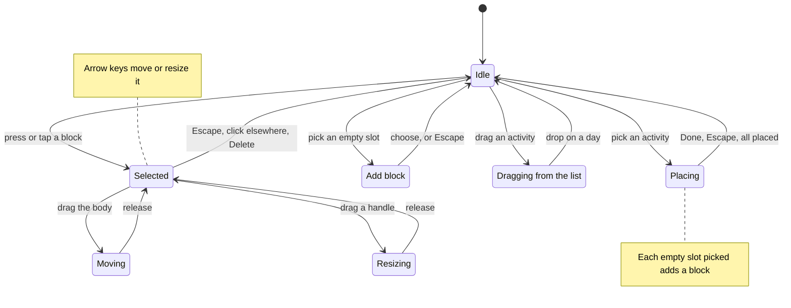

# Interactions

All of these must work with a mouse, touch and the keyboard.

The week is in one of these states at a time. The sections below give the details of each:

Picking means a click, a tap, or Enter or Space on the focused slot or activity. Choosing an activity in Add block, dropping one on a day, and each slot picked while placing add a block; releasing a move or a resize saves it if it changed; Delete removes the block. On touch, only a selected block can be dragged, so the first tap selects and the grid stays scrollable. A mouse press selects and can start a move at once. For about 350ms after a drag ends, clicks are ignored, so the click that ends it doesn't add a block or deselect.

**Adding blocks**
- **Drag from the Activities list** (mouse or pen): a press on an activity followed by more than 4px of movement starts a drag. A chip follows the pointer, and a dashed preview shows where the block will land. Dropping on a day creates the block. The start is the slot under the pointer.
- **Placing:** clicking or tapping an activity starts placing it. The placing toolbar appears: "Placing **Gym** · 1 h 30 min. Click a time slot." ("Tap a slot" on touch) with the activity's left-to-place figure, "Use first free slot" and "Done". While placing, a mouse hovering over the grid shows the preview, and each click or tap on an empty slot adds a block of the default length there. Placing stops on its own once that activity is all placed. Escape and Done also stop it.
- **Add block from an empty slot:** when not placing, clicking or tapping an empty slot highlights it and opens a chooser titled "Add block" with the day and start ("Tuesday · from 10:00"):
  - On phones it is a modal bottom sheet. On wide screens it is a menu anchored to the slot, on its right, or on its left when there's no room on the right (`position-try-fallbacks: flip-inline`), as on the week with the navigation rail expanded.
  - It lists the activities, those with the most left to place first. Activities that are all placed or over budget come last, dimmed but still selectable ("this would go over budget").
  - The phone sheet has a length stepper (− and +, 15 minutes per step), preset to the default length of the activity under focus. The desktop menu uses the default length, and the block can be resized afterwards.
  - It ends with "New activity…", which opens the new-activity form and then adds the block.
  - Choosing an activity adds the block, closes the chooser and shows a snackbar: "Added Gym · Tue 10:00–11:30" with Undo.
  - On touch, a tap on an empty slot must not fire while the user scrolls. Only a tap without movement opens the chooser.
- **First free slot:** scan the days in order, in 15-minute steps within the day hours, for a gap of the default length. For per-day activities, try days that don't have the activity yet first. If nothing fits, show a snackbar ("No free 1 h 30 min slot between 07:00 and 22:00.").
- **Default length:** for per-day activities it's `budgetMinutes`. For weekly ones it's 90 minutes (one lecture slot). Cap it at the remaining budget when some is left, and so it ends by the end of the day hours when it starts inside them. The minimum is 15.

**Editing blocks**
- **Move:** drag the block body, which can cross days. Keep the grab offset so the block doesn't jump. Snap to 15.
  - **Moving changes only the start.** Picking a block up and moving it changes its day and start time. The length never changes. The start is the slot under the block's top edge, anywhere from 00:00 to 23:45.
  - **Overflow into the next day:** if the start plus the length passes 24:00, the block becomes an overnight block. The part up to 24:00 stays in the column under the pointer, and the rest continues in the next day's column from 00:00. A 4-hour block moved to start at 22:00 shows 22:00–24:00 in its column and 00:00–02:00 in the next one. Moving it back up so it fits before 24:00 turns it back into a one-day block. Sunday overflows into Monday.
  - **While dragging:** both parts are previewed in place, as they will be stored. To reach a part that is scrolled out of view, the grid scrolls automatically when the pointer nears its top or bottom edge (see below).
- **Resize:** drag the top or bottom handle (7px tall, 4px on short blocks). The minimum is 15 minutes and the maximum is 24 hours. The top handle keeps the end fixed. Resizing stays within each part's own day: on an overnight block, the first part's top handle changes the start and the second part's bottom handle changes the end. A one-day block becomes an overnight block only by moving it.
- **Select:** a mouse press selects. On touch, the first tap only selects, and only a selected block can be dragged (`touch-action: none` applies only to the selected block and the handles), so the grid stays scrollable.
- **Remove:** the remove button on hover or selection, or Delete/Backspace when the block has focus.
- **Keyboard:** blocks are focusable. Up/Down moves 15 minutes and crosses midnight into the next or previous day, Shift+Up/Down resizes by 15 minutes (also across midnight), Left/Right changes the day, and Escape deselects. Empty slots must be reachable too, so the keyboard can open "Add block". How blocks, slots and the chooser are named and reached is in [Screen readers and the keyboard](accessibility.md).
- Ignore clicks for about 350ms after a drag ends, so the click that ends a drag doesn't add a block or deselect.
- Scroll the grid automatically when dragging near its top or bottom edge.
- The progress indicators and the summary update live during a drag. Persist only when the drag ends, and only if something changed.

**Activities**
- Add with validation messages (from the strict parsers, see [Data model](data-model.md)): "Give the activity a name.", "Enter the hours it needs, for example 1.5." (empty, or 0), "Enter the hours as a number, for example 1.5." (text that isn't a number, such as "1.5h"), "A day has 24 hours. Enter 24 or less.", "A week has 168 hours. Enter 168 or less.", "Enter how many days per week, from 1 to 7." Hours are rounded to 15 minutes.
- **Validation uses the platform's constraint validation**, not a form library and not CSS classes:
  - The inputs carry their own rules (`required`, `min`, `max`), and the browser decides what's invalid. For the rules attributes can't express, and to use the messages above instead of the browser's, set them with `setCustomValidity()` on the field: an empty string when it's valid, so `validationMessage` is always ours.
  - **Timing:** a field shows its error only once the user is done with it: when it loses focus, or when the form is submitted. That's what `:user-invalid` matches, so the error styling and the message (the text field's supporting text) hang off `:user-invalid`. No error shows on an untouched form or while typing for the first time. Run the field's check on every `input` event, so the error clears as soon as the value is fixed.
  - Submitting runs the browser's validation. Handle the `invalid` event with `preventDefault()` to hide the browser's bubble, since the message already shows under the field, and move focus to the first invalid field.
  - The message is linked to its field with `aria-describedby`. Set `aria-invalid` whenever the field matches `:user-invalid` (checked on `blur`, `focus` and `input`), so screen readers hear about the error at the same moment it appears on screen.
  - Hours accept the user's decimal separator ("1.5" and "1,5" in German), read with the separators from `Intl.NumberFormat(…).formatToParts()`.
- Edit inline in the list item (same form, plus Save, Cancel and Delete). Escape cancels.
- Deleting an activity also deletes its blocks. Show a snackbar with Undo: "Deleted Gym and its 3 blocks."
- A new activity gets a default color and shape, ideally ones no other activity uses yet (see Activity shapes in [Design](design.md)). The user can change both.

**History**
- Undo covers every change: block add, move, resize and remove, activity add, edit and delete, Clear week, and Start empty. It keeps up to 100 steps. Ctrl/Cmd+Z works when focus isn't in a form field. The snackbar Undo and the Undo icon button use the same stack.
