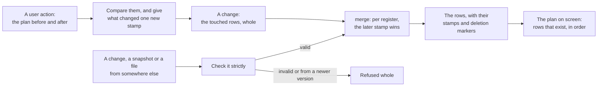

# Merging changes

**Phase 1 of [Network](network.md), designed and not built yet.** How the plan is kept so that two devices that made changes apart end up with the same plan once each has the other's changes, in whatever order they arrive. There is no network in this phase: it changes how the plan is stored and adds the function that merges. The terms node, change and snapshot are from [Network](network.md). The work is [SantaClaas/week-budget-planner#78](https://github.com/SantaClaas/week-budget-planner/issues/78) (this design) and [SantaClaas/week-budget-planner#79](https://github.com/SantaClaas/week-budget-planner/issues/79) (building it).

## Decided

These are rules about what the user gets, so they were the user's to decide. Each is described in the section named.

1. **A delete wins over an edit made at the same time** on another device (see Deleting).
2. **Blocks added to an activity that another device deleted are hidden with it**, and come back if the deletion is undone (see Deleting).
3. **A block moved on one device and resized on another ends up as one of the two left it**, not as a mix (see Registers).
4. **The example week gets new ids each time it is loaded** (see The example week). Today its ids are the same everywhere.
5. **Syncing doesn't depend on the storage level.** A window that can't keep the plan, such as a private one, can still load it from the group and sync for as long as it's open (see The limited storage levels).
6. **Importing a file still replaces the plan.** Merging a file into the plan becomes possible, and is left as a feature of its own, since it needs a screen and copy (see Export and import).

## The idea

A plan is a set of rows: its activities, its blocks and one row of settings. Each row is split into **registers**. A register holds a value and a **stamp** that says when it was written and by which node. Merging two versions of a row takes, register by register, the one with the later stamp. Nothing else is needed:

- **A change** is the rows an action touched, whole, with all their registers and stamps. With a block comes its activity's row, so a change never points at a row the receiver might not have.
- **A snapshot** is every row.
- **Merging** a change, a snapshot, a file or another device's whole state into the plan is the same function.

Because a change carries whole rows, a change never depends on an earlier one having arrived. Merging is then safe however changes arrive: in any order, twice, or with some missing until later. This is a state-based CRDT (a last-writer-wins map, sent as deltas), and the plan is small enough that no library is needed: tens of rows with a handful of registers each.

**Why not a log of operations.** The undo steps record operations ("this block moved from here to there"), and an operation log would merge too. But a log has to be replayed in an order that respects what each operation saw, it grows without bound, and a new device needs all of it or a snapshot plus the rest. With rows and stamps, the current state is all there is to keep and to send.

## Registers

**Fields that one action sets together, or that share a rule, are one register.** Otherwise a merge could combine half of one device's change with half of another's, into something neither made or that breaks the rule.

| Row | Register | Fields | Why together |
| --- | --- | --- | --- |
| Activity | name | `name` | |
| | hue | `hue` | |
| | shape | `shape` | |
| | budget | `mode`, `budgetMinutes`, `days` | a per-day budget is at most a day, so the limit of one depends on the other |
| | order | its place in the Activities list (see Order) | |
| | existence | whether it's deleted | |
| Block | time | `day`, `start`, `length` | moving and resizing set them together, and a block should be as one device left it |
| | existence | whether it's deleted, and its `activityId` | a block's activity is set when it's added and never changes |
| Settings | day start | `dayStart` | 0 to 12 and 13 to 24 never conflict, so each end can be set on its own |
| | day end | `dayEnd` | |
| | example week | `exampleLoadedAt` | |

So renaming an activity on the phone and changing its budget on the laptop both survive. Two devices that set the same register don't: the later stamp wins, and the other value is gone.

## Stamps and the clock

Devices' clocks can't be trusted to agree, so a stamp is a **hybrid logical clock** value: a wall-clock time in milliseconds, a counter, and the id of the node that wrote it. Stamps compare by time, then counter, then node id.

- **One action, one stamp.** Every register an action writes gets the same stamp, made from the action's `now` (see "One action, one `now`" in [`docs/guidelines/principles.md`](../guidelines/principles.md)).
- **A new stamp is later than everything the node has seen.** The node keeps its clock: the latest stamp it has issued or merged. A new stamp takes the later of `now` and the clock's time, and where that time equals the clock's, the clock's counter plus one. So a change made after seeing another device's change is always later than it, whatever the two wall clocks say. Only changes made without knowing of each other are ordered by wall clock.
- **A device whose clock runs ahead wins those conflicts** until the others have merged one of its changes, after which their own stamps are later again. A merge can't refuse a stamp for being in the future, since nodes would then disagree. See A clock that is wrong, below.
- **Equal stamps with different values** shouldn't happen, but can: after a browser profile was copied, or between rows that were stored before stamps existed. The merge then takes the value that sorts later as canonical JSON, so it still gives every node the same result.
- **As text, a stamp sorts the way it compares:** the time as 13 digits, the counter as 6, then the node id, with hyphens between. A counter that would pass 999999 moves the time on by a millisecond instead. The lowest stamp, all zeros with an empty node id, is what rows get that were stored before stamps existed: any real change is later.

### A clock that is wrong

**No scheme can say which of two changes was really later when the devices that made them shared no clock.** "Later" only means something by a clock both trust. What a clock scheme can do is order the changes that knew of each other, which this one does without any wall clock, and pick a winner among the rest that every node agrees on. So a wrong clock can only ever decide a conflict between two changes to the same register made apart, and the cost is one such conflict going to the earlier change.

- **What it costs here is small.** The devices are one person's, their clocks are set by the network to within seconds, the conflict needs the same register changed on two of them while apart, and Undo and the other device's value are both a few taps away.
- **A clock far ahead also dulls the stamps for a while.** Once the others merge its change, their clocks hold that future time, and until real time catches up their stamps differ only by the counter. Changes that know of each other still order correctly; changes made apart are then decided by the counter and the node id, not by time.
- **The fix, in phase 2, uses the server that is there anyway.** Every response from the server carries its time. A node works out how far its own clock is off and corrects the time it stamps with, also while offline, by the last offset it knew. The server isn't the source of truth for time and nothing waits on it: a node that never reaches it stamps with its own clock, as in this phase. No second server is needed.
- **Nothing that must be right may depend on a stamp's time.** How old a deletion marker is, for dropping it, is counted from when the group received it, not from its stamp (see Deleting).

What else was looked at:

- **A counter alone** (a Lamport clock): no wall clock, so no clock can be wrong. Among changes made apart, the device that has made or seen more changes then wins, which has nothing to do with which was later. That is what the stamps fall back to above, and it's worse as the rule.
- **Version vectors** and their relatives (dotted version vectors, interval tree clocks) tell exactly whether two changes knew of each other, without time. They don't pick a winner among those that didn't, so they need the same tie-break, or they keep both values.
- **Keeping both values and asking** (a multi-value register): honest, and no clock decides anything. It needs a screen for conflicts, for something rare and cheap to fix by hand. It stays possible later for a register where a silent loss would hurt.
- **The order in which changes reach the server:** no clocks at all, but then the last device to come back online wins, even with a change made a week before the other's, and two devices syncing directly would have no order.
- **Refusing changes from a clock that is off:** the server can't read stamps, and a node that refused them would end up with a different plan from one that didn't.

**The node id** is a random id like the others (see [Data model](data-model.md)), made the first time the database opens, and stored in it. All tabs of a browser are one node (see Terms in [Network](network.md)): the leader holds the clock and gives each save its stamp, in the save's own transaction. **An imported file brings its node id with it, which must not be kept:** two devices with one node id could issue the same stamp for different values. An import gives the node a new id and keeps the later of the two clocks.

## Deleting

**A deleted row stays, with its existence register set to deleted.** That is the deletion marker. Without it, another device's copy of the row would bring it back.

- **A delete wins over a concurrent edit.** An edit writes other registers and leaves existence alone, so the row stays deleted. The edit is kept in the row and never shown.
- **Undoing a delete** writes existence again, with a new stamp, and the row is back with whatever its registers hold by then.
- **A block shows only while its activity exists.** When one device deletes an activity and another adds a block to it, the block's row merges in but isn't part of the plan. If the deletion is undone, it appears with the activity. Deleting an activity still marks the blocks it had as deleted too, as it removes them today; the rule is for the blocks the deleting device didn't know about.
- **Ids are never used again**, so a deleted row can't be mistaken for a new one.
- **Markers are all kept in this phase.** A marker is one row, and a plan's rows number in the tens. Dropping them needs a bound on how long a device may be away, which is the server's lease (see Leases and nonces in [Network](network.md)), so the rule belongs to phase 2. A marker's age is then counted from when the group received it, which the node records as it merges, not from the stamp, whose time a wrong clock could set. What phase 2 has to settle is written under Returning after a long time.

## Order

**Each activity has an order key, a short text, and the Activities list is sorted by it.** A key can always be made between two others (fractional indexing), so moving an activity gives that one activity a new key between its new neighbors and leaves the rest alone.

- Two devices that move different activities both get their move.
- Two that move the same activity: the later stamp wins, as with any register.
- Two that put different activities into the same gap can make the same key. Equal keys sort by activity id, so every node shows the same order.
- **A change gives new keys to as few activities as possible:** the ones that aren't in order by their existing keys once the largest set that is has been left alone. For one activity dragged to a new place, that is the one.
- A new activity gets a key after the last.

Today the order is a `position` number per activity, and reordering renumbers every row in between. Merged per row, two devices' renumberings would interleave into an order neither made.

## Conflicts, case by case

| Two devices, without knowing of each other | The merged plan |
| --- | --- |
| rename the same activity | the later name |
| rename an activity, and change its budget | both |
| change an activity's budget from per week to per day, and change its hours | the later budget, whole |
| move a block, and resize the same block | the block as the later one left it |
| delete a block, and move it | deleted |
| delete an activity, and add a block of it | the activity and the block are gone; undoing the deletion brings back both |
| delete an activity, and rename it | deleted |
| reorder different activities | both moves |
| set the start of the day hours, and the end | both |
| both set the start of the day hours | the later |
| keep the example week, and start empty | empty: starting empty deletes the rows, and a delete wins |
| add activities or blocks | all of them; nothing is matched by name |

**The merged plan is always valid.** Every value in a register was valid when it was written and is checked again when it's received, registers that share a rule merge as one, a block without a living activity isn't shown, and equal order keys have a fixed order. So `sanitizePlan` leaves a merged plan unchanged, and the tests check exactly that (see Tests).

## What is received is checked

A change, a snapshot or a file comes from outside the code, even when another of the user's own devices made it. It is parsed strictly, with the same rules as the strict parsers in [Data model](data-model.md): every value in range, every stamp well formed, every block's activity id an id.

- **Something invalid is refused whole,** not repaired. Repairing would put a value nobody wrote under a stamp that says a node wrote it.
- **The format has a version.** A change from a newer version is refused, and the node stops merging until the app is updated, as with a plan saved by a newer version (see Export, import and reset in [Persistence](persistence.md)). It never merges what it can't read all of.

## Undo

**Undo stays as it is: in memory, per tab, its own record** ([`src/planner/undo.ts`](../../src/planner/undo.ts)). An undo step holds values before and after; a change holds rows and stamps. They answer different questions, and joining them would tie the undo history to what is stored and sent.

- **Undoing is a new action.** It applies the step backwards to the plan as it is now and saves that, which is how it works today. The save gives it a new stamp, so on every device the undo is the latest word on what it touched.
- **The conflict check covers other devices by itself.** A step can't be undone when what it touched has changed since, whoever changed it. The snackbar's text, "that changed in another tab", needs widening when syncing arrives.
- The undo history as a tree ([SantaClaas/week-budget-planner#71](https://github.com/SantaClaas/week-budget-planner/issues/71)) stays its own idea. Rows and stamps keep no history to read one from.

## The example week

**The example week gets new ids each time it's loaded.** Today its ids come from [`examples/example-week.json`](../../examples/example-week.json) as they are, so every device's example week has the same ids. Two devices that each kept theirs and went on to different plans would then merge register by register into a mix of both, as if they were one plan edited twice. A row's identity has to come from one act of creating it. With new ids, merging two such plans gives all the activities of both, which is plain to see and to clean up.

`exampleLoadedAt` is a register like any other. What a device does with its own plan when it joins a group (drop an untouched example week, replace its plan, or merge it in) is phase 2's question.

## Storage

The rows stay in the tables they're in, with their stamps beside their values, so a row and its stamps can't drift apart and one transaction still writes one action.

- **`activities`:** `position` is replaced by `order_key` (text). New: `is_deleted`, and a stamp for each register: `name_stamp`, `hue_stamp`, `shape_stamp`, `budget_stamp`, `order_stamp`, `existence_stamp`.
- **`blocks`:** new: `is_deleted`, `time_stamp`, `existence_stamp`. The foreign key to `activities` holds, since a deleted activity's row stays.
- **`settings`:** new: `day_start_stamp`, `day_end_stamp`, `example_loaded_at_stamp`.
- **`node`** (new, one row): `node_id` and `clock`, the latest stamp issued or merged.
- **The rows and the merge are also a type and a function in memory,** which the database reads into and writes from, so they work without it (see The limited storage levels).
- A stamp column is text with a `CHECK` on its form.
- **Reading the plan** takes the rows that aren't deleted, the blocks whose activity isn't either, and the activities in order of `order_key`, then id.
- **Saving an action** compares before and after as it does now. A removed row becomes an update that marks it deleted; a changed register gets the action's stamp.
- **The migration** gives every existing row the lowest stamp in each register, turns `position` into evenly spread order keys, and leaves `node` to be filled when the database next opens.
- **Size:** a stamp is about 33 characters, and an activity has six. A plan with 20 activities, 60 blocks and as many deleted rows again grows by a few tens of kilobytes.

## Export and import

- **An export** is the database file, as now. It holds the stamps, the deletion markers and the node id.
- **An import replaces the plan,** as now, after the same checks. It then gives the node a new id (see Stamps and the clock).
- **A file from before stamps** is migrated on its copy like any older export, which gives its rows the lowest stamp.
- **A `.json` file** has no stamps. Importing one at the full level is an action like any other: the plan before, the file's plan after, saved with a new stamp.
- **Merging a file into the plan** needs nothing more than the merge. It would let two devices exchange changes by file before any server exists, or bring back one deleted activity from an old export. It needs a choice on the import dialog and copy for it, so it's left as a feature of its own.

## The limited storage levels

**The merge doesn't depend on where the rows are kept.** It works on rows in memory, and the database is one place to keep them. So a window without the database (see Progressive enhancement in [Persistence](persistence.md)), such as a private one, can sync in phase 2: it loads the group's snapshot when it opens, merges what arrives, and sends its own changes as they're made.

- **What such a window can't do is keep changes it hasn't sent.** Closed while offline, they're gone, as everything is at the level with no storage. The save status has to say so.
- **It is a node of its own for as long as it's open,** with a new node id each time, since it has nowhere to keep one, and it tells the group that it's temporary, so it can be let go when it closes (see Removing a device in [Network](network.md)). Without the database there's no leader either, so each such tab is its own node with its own connection.
- **In this phase nothing changes at these levels.** They keep the plan as JSON without stamps, as now, and a plan made there reaches the full level by a `.json` import. Whether the level with `localStorage` should keep stamps too, so unsent changes survive a reload, is decided with phase 2.

## Returning after a long time

This is for phase 2, since it depends on the lease. It's written down because it decides whether markers can ever be dropped, and the format above has to allow it.

The danger: once the other devices have dropped a marker, a device that was away since before the deletion still has the row, and merging its row would bring it back. So a device that returns after its lease doesn't merge its state. It takes the group's snapshot and carries over only what it never sent, by the stamps later than its last sync:

- **A row it created itself and never sent** is added, with a new existence stamp.
- **A row that is in the snapshot** merges as usual.
- **A row it edited that isn't in the snapshot** was deleted while it was away. The edit is dropped, which matches "a delete wins".

An old `.db` file imported and then merged, should that feature come, is the same case, and gets the same rule.

## Tests

The merge is pure, so its tests need no browser (see [`docs/guidelines/tests.md`](../guidelines/tests.md)):

- **Simulation:** several nodes in one process, each with its own rows and clock, and a seeded scheduler that delivers changes late, twice, out of order or not at all until a final exchange of snapshots. The same seed replays the same run. Wall clocks are part of what the seed sets, including clocks that disagree.
- **What must hold after every run:**
  - nodes that merged the same changes have the same rows and show the same plan;
  - merging the same change again changes nothing, and neither does the order of merging;
  - a value a node saved is still there, unless a later stamp replaced it or its row was deleted;
  - the plan shown passes `sanitizePlan` unchanged.
- **Each case in Conflicts, case by case, by name.**
- **The checks on what is received:** what they accept, and each thing they refuse.
- **The migration:** an existing database opens with the same plan, in the same order.
- The merge module is added to the mutation run (see Mutation testing in [`docs/guidelines/tests.md`](../guidelines/tests.md)).

## What changes in the rest of the spec

Made together with the code, so the spec doesn't describe what isn't built:

- [Data model](data-model.md): the example week's ids; that a plan is read from rows that exist; "Sanitize every loaded plan (from storage or sync)" gets the strict check for what is received.
- [Persistence](persistence.md): Suggested tables; Writes and undo (a save stamps what it writes, a delete marks); Export, import and reset (the new node id after an import).
- [Interactions](interactions.md): Reorder, where it describes how the order is stored.
- [Network](network.md): the terms below.

## Terms

Technical terms, for code and docs (see Terms in [Network](network.md)):

| Term | Meaning |
| --- | --- |
| **Register** | The smallest part of a row that merges as one: a value, or a few fields that belong together, with a stamp. |
| **Stamp** | When a register was written and by which node: a time, a counter and a node id. The later stamp wins. |
| **Clock** | The latest stamp a node has issued or merged. Its next stamp is later than that. |
| **Deletion marker** | A row whose existence register says deleted. It stays so that other devices' copies of the row don't bring it back. |
| **Order key** | The text an activity is sorted by in the Activities list. A new one can be made between any two. |
