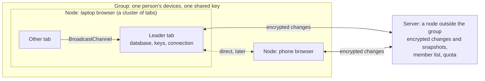

# Network: syncing between devices

**This is a direction, not a spec yet.** Nothing here is built. The app has no backend today (see [Persistence](persistence.md) and [Security](security.md)), and it stays fully usable without one: everything in this file is a progressive enhancement on top of the plan in this browser. The file records what is decided, what is planned in which order, and what is still open, so each phase can become issues and be built on its own. It started as [SantaClaas/week-budget-planner#26](https://github.com/SantaClaas/week-budget-planner/issues/26).

The planner is also the proving ground for infrastructure meant for other apps later. So some choices here are more general than one week plan needs, and they say so.

## Goals

- **A person's plan is the same on all their devices**, including when they edited on two of them while offline.
- **Local-first.** Every device holds the whole plan and works without a network. Data lives on the user's devices by default, and something goes on a server only when it has to.
- **The server can't read the plan.** It stores and forwards encrypted changes it has no key for. It should also learn as little as possible about who syncs what and when (see What the server learns).
- **Syncing works when every other device is offline.** Devices are rarely online at the same moment, so something with better availability has to hold the changes in between. That is the server's job.
- **Later, not now:** sharing a plan with other people.

## Terms

These are technical terms for code and docs. The copy will say "device", and what else it says is decided with the screens (see Names in [`docs/guidelines/principles.md`](../guidelines/principles.md)).

| Term | Meaning |
| --- | --- |
| **Node** | One participant with its own key pair: a browser profile on a device, or a server. Everything that takes part is a node. |
| **Cluster** | The processes of one node. They share the node's keys and trust each other fully, so there is no cryptography between them. The open tabs of one browser are a cluster: one of them is the leader, holds the database (see The database in [Persistence](persistence.md)), and will hold the node's keys and its one connection to the outside. |
| **Group** | The nodes that share one plan and the key to read it: a person's devices. Later this can be an MLS group. |
| **Server** | A node that is a peer on the transport, but not a member of any group. It keeps each group's encrypted changes and hands them to the group's members. |
| **Change** | What one user action did to the plan, in a form that merges (see Phase 1). |
| **Snapshot** | The whole plan at one point, encrypted like a change. It replaces all the changes before it. |

Don't say "ring": it suggests a hash ring, which this design doesn't have.

## Decided

- **The server is a progressive enhancement.** Without it, the app is what it is today. Syncing directly between two devices that are both online stays possible in the design, but it isn't built first, since it's the worse experience.
- **The server is a peer, not a member.** It speaks the same protocol as a device and is addressed the same way, which keeps the architecture to one kind of participant. It never gets a group's key.
- **The server only appends.** It can't read changes, so it can't merge or shrink them. It keeps an append-only log of encrypted changes per group, with a storage limit. A device makes room by uploading a snapshot and telling the server to drop everything before it. The limit is what makes devices do that.
- **A simple group key first, MLS later.** At the start, the devices of a group share one key. Every message carries the key's epoch from the first version, so MLS can replace the key handling later without a new format.
- **Who may use the server:** invite codes and passkeys. The server is run by the project's author.
- **The server also serves the app**, from the same origin as its API, once it exists. That avoids cross-origin requests and their rules (CORS, cookies across sites), and the server can send real headers, which GitHub Pages can't (see Hosting below).
- **Putting state on the server is fine where it's needed.** An invite code that works once, a group's member list and a blocklist can't live on the client alone.
- **Rust where there's a reason.** The server is Rust. In the app, a library that is Rust compiled to WebAssembly under a JavaScript wrapper is used as the Rust crate directly, in one WebAssembly module of our own. The app's own logic stays TypeScript until something needs it moved. The merge logic has no need to be shared with the server, because the server never merges.
- **Deterministic simulation testing from the first line** (see Testing).

## Phases

### Phase 1: changes that merge

No network. The plan's changes get a form in which two devices that saw the same changes end up with the same plan, in whatever order the changes arrived (a CRDT, a conflict-free replicated data type).

- **A starting point, to be confirmed by the phase's own design:** the plan is a small set of activities and blocks with a few fields each, so a last-writer-wins value per field, with a marker left behind for each deleted row, is likely enough. That needs a clock that orders changes across devices without trusting their wall clocks (a hybrid logical clock), and no CRDT library.
- **The groundwork exists.** Undo already records what each change did instead of the whole plan before it ([`src/planner/undo.ts`](../../src/planner/undo.ts), see Writes and undo in [Persistence](persistence.md)). `sanitizePlan` already repairs what a merge can break, such as a block whose activity was deleted on another device (see [Data model](data-model.md)).
- **A pure core.** Merging is a pure function, and the protocol is a state machine that takes messages and the time and returns messages and changes to apply (see "A pure core, with side effects at the edges" in [`docs/guidelines/principles.md`](../guidelines/principles.md)).
- **Open:** how the changes are stored in SQLite and migrated; what export and import do with them; how the order of the Activities list merges (undo records a list index today); whether undo and merge share one record of a change; and whether import could merge a file instead of replacing the plan.

### Phase 2: the server

A device signs in, joins or creates a group, and syncs its changes through the server.

- **Server:** Rust with [axum](https://github.com/tokio-rs/axum), built from actors as in Alice Ryhl's [Actors with Tokio](https://ryhl.io/blog/actors-with-tokio/). [`docs/guidelines/`](../guidelines/) gets a `rust.md` with the first Rust code, and [`docs/guidelines/principles.md`](../guidelines/principles.md) is checked against it.
- **Access:** an invite code is needed to register a passkey. Passkeys sign a device in.
- **Transport, to be decided by a spike:** [iroh](https://www.iroh.computer/) if it works in a browser. Then the server is just another iroh node, and direct sync between devices comes almost for free later. A browser has no raw UDP, so expect connections through relays only; a public relay is acceptable, since iroh encrypts between the two nodes' keys and a relay sees only who talks to whom. If iroh doesn't work in a browser, a WebSocket to the server does. The protocol doesn't know its transport, so this can change.
- **Encryption:** every change and snapshot is encrypted on the device with a key derived from the group key, with authenticated encryption. What a message is for (the group, the key epoch, the kind of message) is bound into it, so it can't be replayed in another place.
- **The app's side:** the leader tab holds the node's keys and the one connection. The Content Security Policy has to allow that connection (`connect-src`, see [Security](security.md)). The app explains syncing in its own UI before it uses the network for it (see Browser permissions in [Security](security.md)). The save status in the top app bar needs states for syncing.

### Hosting

Serving the app from the server's origin changes more than the address:

- **The headers come from the server.** The cross-origin isolation headers and the whole Content Security Policy, `frame-ancestors` included, are sent as headers. The service worker no longer has to add them, and the limited storage level it causes on a first visit or with service workers blocked goes away for that reason (see Hosting and Progressive enhancement in [Persistence](persistence.md)).
- **The app must still open when the server is down or the device is offline**, or it isn't local-first. So the service worker stays, to keep the app's files (see installing as a PWA in the [overview](overview.md)).
- **A new origin starts empty.** The database, the settings and a passkey's scope all belong to the origin, so a plan saved on GitHub Pages doesn't appear at the new address. Moving needs a path for the people already using it: an export there and an import here at least, with the old address pointing the way. Choose the domain once, since passkeys are tied to it.
- **Whoever serves the app's code could change it.** A server that can't read the plan could still send a page that reads it and sends it away. That was true of GitHub Pages too, but now it's the same server that stores the encrypted changes. It goes in What the server learns.
- **Open:** whether GitHub Pages keeps serving the app without syncing, or redirects.

### Later

- **MLS** (Messaging Layer Security, RFC 9420), through [OpenMLS](https://openmls.tech/), in place of the simple group key. It adds forward secrecy, recovery after a key leaked, and removing a member without handing out a new key by hand. The server takes the role MLS calls the delivery service. MLS needs a group's commits in one order, which the server can give without reading them.
- **Sharing a plan with other people**, which is what MLS is really needed for.
- **Direct sync between devices** that are online together.
- **Hiding more from the server** (see What the server learns).

## What the server learns

The server can't read a plan. This is what it still sees, and it's the threat model to keep honest as the design gets detailed:

| It sees | Why | What could reduce it |
| --- | --- | --- |
| A group's identifier and its member nodes' public keys | to store and hand out the right log, and to refuse removed devices | identifiers that say nothing about the person |
| Which account (invite code, passkey) uses which group | to limit who may use the server | anonymous tokens: the account proves it may use the server and gets tokens that can't be linked back to it (later) |
| How many changes, how big and when | it stores them | padding to fixed sizes; batching |
| IP addresses and when a device is online | it's a network service | not solved here |

**The server is trusted for the app's code.** It serves the page, so the promise that it can't read the plan holds only as long as it serves the code in this repository. The web has no good way yet for a user to check that. What helps: the code is public, the build can be made reproducible, and an installed app only changes when its service worker updates.

## Removing a device

- **A device removes another device**, as in a chat app's list of signed-in devices. The server doesn't decide; it keeps the group's current member list and refuses a node that's no longer on it. The remaining devices get a new group key.
- **The race to solve:** someone who holds a stolen, unlocked device could remove the owner's other devices first. MLS doesn't prevent this either: any member can remove another, and the policy is the application's. A member change therefore needs proof that the owner is present. Two candidates: a fresh passkey check with user verification, or a recovery key shown once when the group is created.
- **Other cases that need state on the server:** blocking an account, a passkey the user removed, and the storage used (the server holds the data anyway).

## Ideas for the infrastructure

These come from the wider goal of infrastructure for several apps. The planner needs little of it, since almost nothing in a plan needs a server's approval. They are recorded so they aren't lost, and none of them blocks the phases above.

- **Server data that lives on the client.** What the server must approve, it signs and hands back to the client, which presents it when needed. What must stay secret from the client, the server encrypts and stores on the client. A data export is then nearly free, because the data is already with the user. Known limits:
  - A client can present an old version that was valid once. A lease (a short expiry, renewed regularly) bounds that, and keeps a blocklist short: an entry only has to live until the lease runs out.
  - Anything that may happen only once needs state on the server.
  - A signature if other nodes have to check the approval, as with a certificate authority. A MAC (message authentication code) only if the server alone checks it.
  - Data the server encrypts so that the user can't read it is still data about the user.
  - Passkeys can't work this way alone: a new device has the passkey, synced by the platform, but not the record the server signed, and that's the device that needs to sign in. The server keeps the credential identifier and public key.
- **A key per user that no server stores.** The WebAuthn PRF extension derives a secret from the passkey on the device. It could wrap the group key, so a new device with the same passkey could unwrap it without pairing. Support differs between browsers and passkey providers, and needs checking.
- **A key per operation**, derived from a server key and a random identifier the client sends. The server can derive it again whenever it sees the identifier, so this hides nothing from the server. It does separate keys and rules out reusing a nonce under one key.
- **Resisting oracle attacks:** the server only ever decrypts with authenticated encryption, compares in constant time, and binds the user, the purpose and the expiry into everything it signs or encrypts. Replays are a separate problem, answered by the leases and nonces above.
- **Actors on every node.** The tab cluster already works like one: the leader's database service is a single activation that other tabs call without knowing where it runs, as with the virtual actors of Microsoft's [Orleans](https://www.microsoft.com/en-us/research/publication/orleans-distributed-virtual-actors-for-programmability-and-scalability/). Tabs could host more actors to share work.
- **Not adopted:** a distributed hash table of our own to find nodes (a person's few devices need a meeting point, not a routing ring, and iroh brings its own discovery), and nested groups as a "tree of rings" (an MLS group's tree is how it updates keys, not a network layout, and a member is always one client).

## Testing

**Deterministic simulation testing.** Because the protocol is a pure state machine, a test can run several nodes and a server in one process, with a seeded scheduler that delivers, delays, drops, duplicates and reorders messages and moves the clock. The same seed replays the same run. The tests check that all nodes end up with the same plan, that nothing a device saved is lost, and that a removed device gets nothing new. Time and identifiers are passed in, as everywhere else in the code.

## Observability

Messages can carry a W3C Trace Context `traceparent`, so one action can be followed from a tab through the leader and the server to another device, with OpenTelemetry. It travels inside the encrypted part, or the server could link messages by it. Sending traces anywhere needs the user's consent first (see Monitoring under "Where rules are enforced" in [`docs/guidelines/principles.md`](../guidelines/principles.md)).

## What changes in the rest of the spec

When a phase is built, these get revised with it:

- [Persistence](persistence.md) and [Security](security.md) say there is no backend and no account.
- [Security](security.md): the Content Security Policy becomes a header and allows the sync connection (`connect-src`, if the transport leaves the origin, as iroh's relays do), and the second WebAssembly module.
- [Persistence](persistence.md): Writes and undo, the save status, export and import, and Hosting (the server serves the app from its own origin, see Hosting above).
- [`docs/LOADING.md`](../LOADING.md): the WebAssembly module gets a tier. It should load only for users who sync.
- [Browser support](browser-support.md): whatever the transport and the passkeys need.

## Sources

- Ink & Switch, [Local-first software](https://www.inkandswitch.com/essay/local-first)
- Sylvain Kerkour, [What distributed systems and end-to-end encrypted apps have in common? CRDTs and Rust!](https://kerkour.com/rust-crdt-love)
- [RFC 9420](https://www.rfc-editor.org/rfc/rfc9420), the Messaging Layer Security protocol, and [OpenMLS](https://openmls.tech/)
- [iroh](https://www.iroh.computer/)
- Alice Ryhl, [Actors with Tokio](https://ryhl.io/blog/actors-with-tokio/)
- Microsoft Research, [Orleans: Distributed Virtual Actors for Programmability and Scalability](https://www.microsoft.com/en-us/research/publication/orleans-distributed-virtual-actors-for-programmability-and-scalability/)
- Leads looked at for the merge, in case the simple approach isn't enough: [cr-sqlite](https://github.com/vlcn-io/cr-sqlite), [Automerge](https://github.com/automerge/automerge), [Yjs](https://github.com/yjs/yjs), and Turso's own sync
