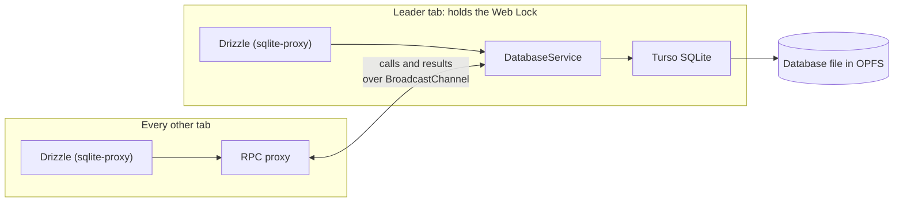
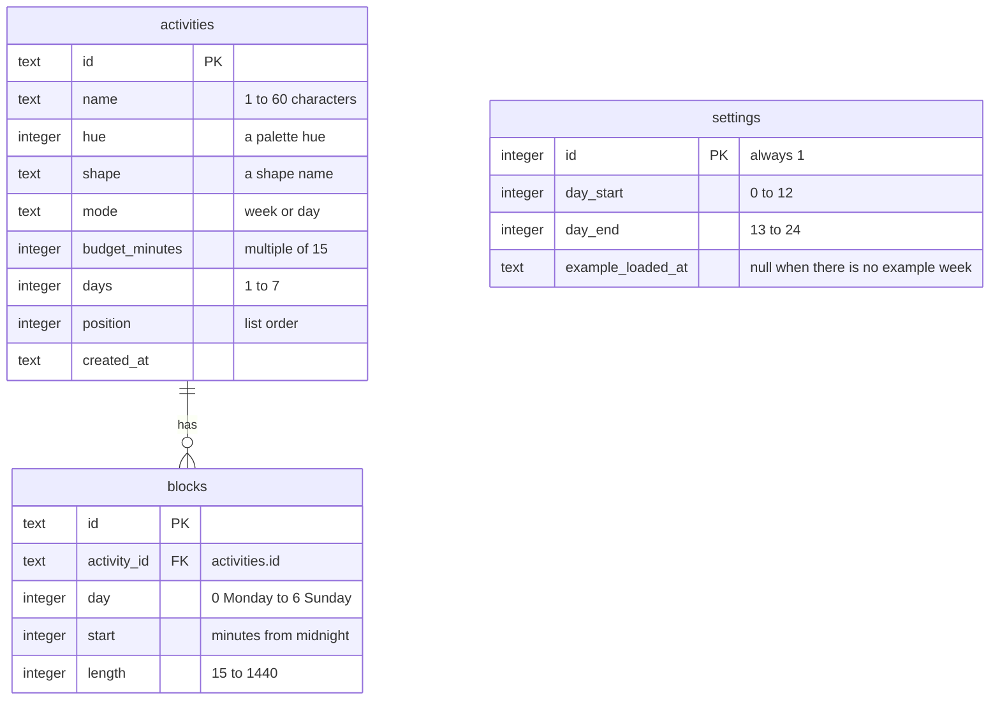
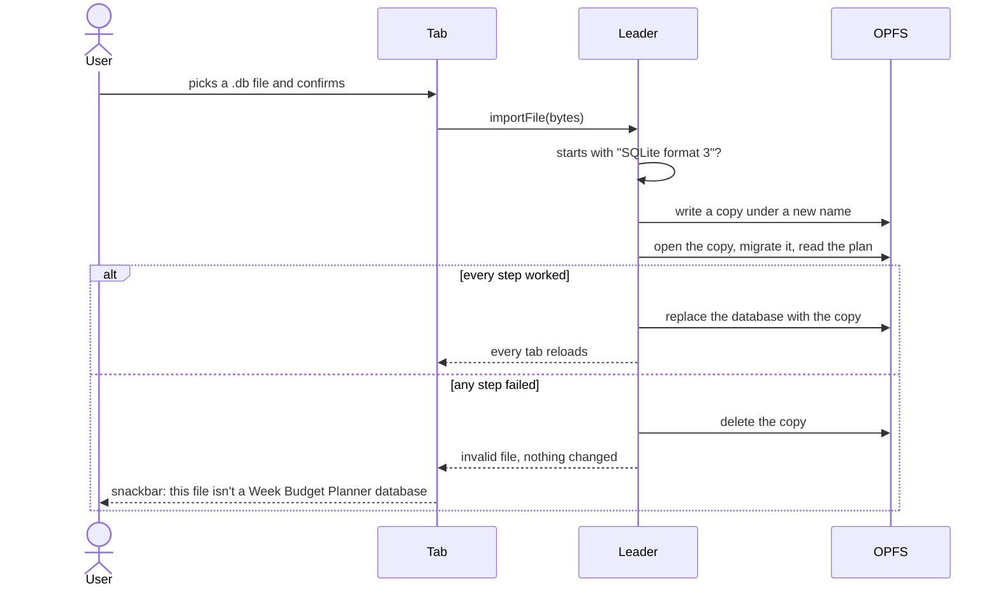
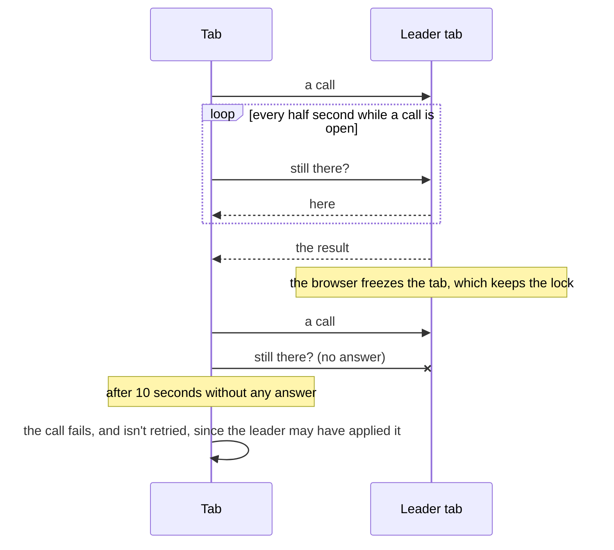
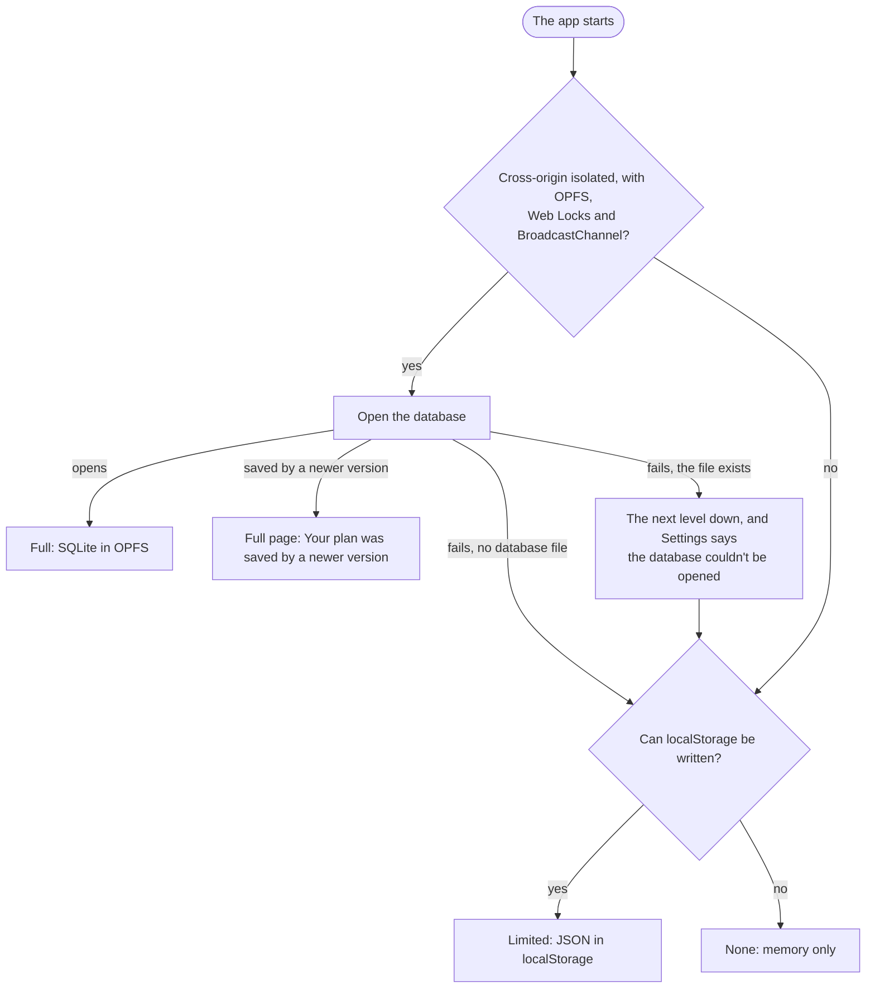

---
paths:
  - "src/database/**"
  - "src/storage/**"
  - "drizzle/**"
  - "drizzle.config.ts"
  - "public/service-worker.js"
  - "public/_headers"
---

# Persistence

In the prototype, the plan lived in the claude.ai artifact database. That API exists only inside claude.ai artifacts and is **not** carried over. The real app stores everything in a **SQLite database inside the browser**, set up the same way as [flashcut](https://github.com/SantaClaas/flashcut), with **Drizzle** added on top. There is no backend.

## Database engine (same as flashcut)

- `@tursodatabase/database-wasm`, persisted in OPFS. Import it from `@tursodatabase/database-wasm/vite`.
- It needs `SharedArrayBuffer`, so the page must be cross-origin isolated (`Cross-Origin-Opener-Policy: same-origin` and `Cross-Origin-Embedder-Policy: require-corp`) in dev, preview **and** production. Set the headers in [`vite.config.ts`](../../vite.config.ts) for `server` and `preview`, and keep [`public/_headers`](../../public/_headers) for hosts that read it. Production is GitHub Pages, which can't set headers, so a service worker adds them there (see Hosting).
- **Multiple tabs (already built in flashcut, reuse it):** OPFS allows one open database per origin. Flashcut's `src/db/client.ts` elects a leader with `navigator.locks.request(...)`. The tab holding the lock opens the database, runs migrations, and serves a `DbService` (`exec`/`run`/`get`/`all`/`exportFile`/`importFile`/`wipe`). `src/lib/broadcast-service.ts` exposes that service to the other tabs as a typed RPC proxy over BroadcastChannel. It handles request ids, provider discovery, retrying calls that were never sent when a tab gets promoted, and `CallLostError` for calls in flight when the leader changes. Copy both files with only renames (channel and lock names). Don't build a second mechanism.
- **Cross-tab updates:** after a write, broadcast a change event so other open tabs reload the plan (flashcut's `src/lib/broadcast.ts` pattern). A tab never receives its own broadcast.

How the tabs share the one database. Every tab runs the same typed Drizzle queries; only the leader has the database open:



When the leader tab closes, its lock is released and another tab takes it over, opens the database and starts serving. Calls that were never sent go to the new leader; calls in flight fail with `CallLostError` (see Calls between tabs).

## Drizzle (new compared to flashcut)

- Use `drizzle-orm@1.0.0-rc.4` and `drizzle-kit@1.0.0-rc.4`, pinned exactly. The 1.0 line ships `drizzle-orm/tursodatabase/wasm` and a filesystem-free `drizzle-orm/tursodatabase/wasm-migrator`, and 0.45 doesn't have them. Check the installed package's types before relying on these details.
- **Schema** in [`src/database/schema.ts`](../../src/database/schema.ts). Migrations are **generated** with `drizzle-kit generate` into [`drizzle/`](../../drizzle/) and committed. Never hand-edit an applied migration.
- **Drizzle sits on top of flashcut's RPC; it doesn't replace it.** Follower tabs have no local database object, so the app's Drizzle instance uses `drizzle-orm/sqlite-proxy`. That driver has no database of its own. It builds the SQL, calls one async callback with `(sql, params, method)`, and maps the returned rows to typed results. The callback just calls the existing `dbService`, which runs the SQL locally on the leader and over BroadcastChannel everywhere else. So every tab uses the same typed queries.
  - **Row shape:** the proxy expects rows as arrays of values in column order (one row for `method === "get"`, a list otherwise). Flashcut's `DbService` returns rows as objects, so add a method that returns arrays, for example using Turso's raw statement mode if its API has one (check it), and verify against Drizzle's sqlite-proxy docs and types.
  - **Atomic writes:** `database.transaction()` over the proxy would send BEGIN, the statements and COMMIT as separate RPC calls, so another tab's query could land in between. Instead, pass Drizzle's batch callback (`drizzle(callback, batchCallback, config)`) and add a `DbService.batch(statements)` that the leader runs inside one transaction (flashcut's `withTransaction`). Use `database.batch([...])` for every multi-statement user action.
- **Migrations are loaded only when a database needs them.** Each generated `migration.sql` becomes a chunk of its own (a lazy `import.meta.glob`). At open, one query reads the names of the applied migrations from Drizzle's `__drizzle_migrations` table. If none are pending, nothing else is loaded. Otherwise the leader loads the pending SQL files and Drizzle's migrator and passes only the pending migrations, since Drizzle runs every migration whose name isn't in its table yet. So migrations every database already has cost nothing but their name, however many there are. If the list grows long, new databases could later start from a baseline instead of replaying the full history.
- **Migrations run only on the leader**, on its real connection, before it starts serving, using the `wasm-migrator`, which takes the pending migrations' SQL as a `Record<string, string>` keyed by name. Drizzle tracks applied migrations in its own table. Don't mix that with flashcut's `PRAGMA user_version` scheme.
- **Tests** run in Node against `@tursodatabase/database` (the same async API), applying the same generated migrations and going through the same sqlite-proxy adapter the app uses (`createLocalQueryService` in [`src/database/connection.ts`](../../src/database/connection.ts)), so the proxy path is tested too. No browser is needed for repository tests.

## Suggested tables

Map the data model above roughly like this. Adjust it if Drizzle suggests better, but keep minutes as integers.

- `activities`: `id` text PK, `name`, `hue` int, `mode` text (`week`/`day`), `budget_minutes` int, `days` int, `shape` text, `position` int (list order), `created_at` text
- `blocks`: `id` text PK, `activity_id` text → activities (delete its blocks together with the activity, in one transaction), `day` int 0–6, `start` int, `length` int
- Every column with rules has a `CHECK` constraint for them, generated by drizzle-kit from `check()` in the schema: id lengths, `name` length, the palette hues, `mode`, multiples of 15 and the ranges of `budget_minutes`, `days`, `day`, `start`, `length`, `day_start` and `day_end`. Turso enforces them.
- Every table is `STRICT`, so a column only takes values of its own type. drizzle-kit can't generate `STRICT` yet, so the generated SQL gets it by hand, in `drizzle/<timestamp>_<name>/migration.sql`, and a test fails if any table goes without it (for example after drizzle-kit rebuilds a table in a later migration). A `STRICT` table refuses a `CASE` in a `CHECK`, whose type it can't tell, so checks use `AND` and `OR` instead.
- `settings`: a single row with `day_start`, `day_end`, and `example_loaded_at` (text, ISO 8601, null when there is no example week). The theme isn't stored here (see [Data model](data-model.md)).

The tables as built in [`src/database/schema.ts`](../../src/database/schema.ts):



## Writes and undo

- Write when an action is complete: block added, drag or resize finished, keyboard nudge, activity saved. Never write per pointermove. Make one transaction per user action.
- Undo stays in memory, as in the prototype. Applying an undo step writes the restored state back in one transaction.
- The status in the top app bar says whether and where the last change is saved: "Saved in this browser", "Saving…", "Saved in limited storage" (see Progressive enhancement, which includes a database that won't open), or "Not saved". It is a link to Settings › Your data, so every question about the data ("saved how safely?") lands where the answers and actions are: keeping the plan, a broken database, export.
- **The status never shows whether the browser keeps the plan** (see Keeping the data). That's about the future, not the last change, and most browsers don't grant persistent storage to a new site, so it would be a warning for nearly everyone nearly all the time, and "Not saved" would stop standing out. Storage problems that change what happens to a change (limited storage, no storage) do show there. On a write error, show a snackbar that explains what failed, with Retry ("Couldn't save your last change. It's still on screen."), and keep the in-memory state.

## Export, import and reset (required)

Backup works like flashcut's (`src/lib/db-file.ts`, `src/lib/download.ts`, and `exportFile`/`importFile`/`wipe` in `src/db/client.ts`):

- **Export database:** downloads the raw SQLite file as `week-budget-planner-YYYY-MM-DD.db` (`application/vnd.sqlite3`). The leader runs `PRAGMA wal_checkpoint(TRUNCATE)`, briefly closes the database, reads the file bytes from OPFS, then reopens. Calls that arrive in the meantime queue behind the reopen. Export works from any tab.
- **Import database:** the user picks a `.db` file and confirms in a native `<dialog>` ("Replace your plan?") that names the file and how many activities and blocks it replaces, with a link to export first. The leader closes the database, deletes the stale `-wal`, writes the file and makes every tab reload. Run migrations on the imported file at open, so older exports still load.
- **An import never replaces the plan with something that can't be opened.** Before touching the database, the leader checks that the file starts with the SQLite header (the 16 bytes `SQLite format 3\0`), then writes it to a separate file in OPFS (a new name for each try, because the engine keeps a file it failed to open locked until the page reloads; the leader removes leftover copies when it opens the database), opens that copy, runs the migrations on it and reads the plan from it. Only if all of that works does it replace the database. Otherwise the plan stays as it was, the copy is deleted, and the snackbar says: "This file isn't a Week Budget Planner database, so nothing was changed." A `.json` file has to be a plan in the stored format, or the snackbar says: "This file isn't a Week Budget Planner plan, so nothing was changed."


- **A file from a newer version of the app is refused**, since this version can't know what the newer one changed. A `.db` file is newer when Drizzle's table lists a migration this version doesn't have; a `.json` file is newer when its `version` is above 1. Nothing is changed, and the snackbar makes it actionable: "This file is from a newer version of Week Budget Planner. Reload to update the app, then import it again." with the action "Reload".
- **A plan saved by a newer version** (the database lists a migration this version doesn't have, for example after another tab updated the app) is neither opened nor replaced by a fallback. The app shows a full-page state instead: "Your plan was saved by a newer version" with "Reload to update Week Budget Planner. Your plan is safe, and nothing was changed." and a filled "Reload" button. This works in every tab, including tabs that reach the database through the leader.
- **Delete all data:** confirm, delete the database files and reload every tab.
- **While the database is closed** for an export, an import or a delete, calls from every tab wait. After an export they continue on the reopened database. After an import or a delete they never run, because every tab reloads. Nothing may reopen the database in between. An export reopens the database even when reading the file failed.
- Deleting a file that doesn't exist is fine. Any other error deleting or writing a database file fails the action and is shown to the user. It is never ignored.
- **A database that can't be opened isn't hidden.** If the database file exists but fails to open, the app falls back to limited storage (see Progressive enhancement), and Settings › Your data says so in an error-colored notice: "The database in this browser couldn't be opened. So your plan is in limited storage for now. Import a backup, or delete all data to start over." with the buttons "Import backup" and "Delete all data" Delete all data then also deletes the database files. It marks them for deletion in `localStorage` (`week-budget-planner.remove-database`, holding the time it was asked for) and reloads every tab, and the next leader deletes them before it opens anything, since the engine keeps a file it failed to open locked.
- At the limited storage levels (see Progressive enhancement), export and import use a `.json` file of the plan instead. The full app also imports such a `.json` file.
- These live on the Settings page (see [Layout](layout.md)), which says that the data lives only in this browser and that export is the backup.

## Keeping the data

Browsers may delete a site's storage when space runs low, unless the site has persistent storage. Safari also deletes storage written by script after 7 days without a visit, unless the site was added to the home screen.

The app asks the user before it asks the browser (see Browser permissions in [Security](security.md)):

- **Ask only once the user has made something worth keeping:** after the first saved change to their own plan (not the first-run save, and not while the example week is shown). Before that it would be noise about an app they haven't learned yet.
- **The ask is a card**, not a snackbar, at the top of the Activities pane (on phones, the Activities screen), in the same place and style as the example-week card: "**Your browser may delete your plan** if it runs low on space. Ask it to keep your plan?" with the buttons "Not now" and "Keep it". It stays until answered, without covering the week or holding up other snackbars, since only one snackbar shows at a time and "Deleted Gym and its 3 blocks · Undo" must never wait. The two cards never show together, because this one only appears once the example week is gone. Show it only if `navigator.storage.persisted()` is false.
- Only "Keep it" calls `navigator.storage.persist()`. Chrome and Safari then decide on their own, and Firefox shows its prompt, which now follows a reason the user just read and a choice they made.
- After "Keep it", the card goes away and a snackbar reports the browser's answer: "This browser will keep your plan.", or "This browser didn't agree to keep your plan. Export now and then to keep a copy." with the action "Export".
- "Not now" stores the time in `localStorage` (`week-budget-planner.keep-plan-dismissed-at`), and the card doesn't come back. Settings still offers it.
- Settings › Your data shows the state from `navigator.storage.persisted()` as its first row, "Keeping your plan", with a shield icon (`verified_user`, `gpp_maybe` or `gpp_bad`). Persisted: "This browser keeps your plan until you delete it." Not persisted: "This browser may delete your plan when it runs low on space. Export now and then to keep a copy." with a "Keep my plan" button that calls `persist()`. If the browser said no (`navigator.permissions.query({ name: "persistent-storage" })` is `denied`), say so instead of offering the button again: "This browser didn't agree to keep your plan. Export now and then to keep a copy."

The design canvas has every state above on its "Your data" board, and the Settings boards show the row in place.

## Calls between tabs

A leader can stop answering without letting go of the lock, for example when the browser freezes a background tab. So while a tab has calls open, it asks every half second whether the leader is still there, and gives up after 10 seconds without any answer. The leader starts answering as soon as it holds the lock, even while its database is still loading, so a slow first download doesn't count as silence. After the time limit the call fails like any failed write ("Couldn't save your last change. It's still on screen."), or, while opening, the app falls back to limited storage. A call that timed out may still have been applied by the leader, so it isn't retried on its own.



## Hosting on GitHub Pages

- The app is a static site on GitHub Pages, deployed by [`.github/workflows/deploy.yml`](../../.github/workflows/deploy.yml) (pnpm install, test, build, then the Pages actions) on every push to `main`. The repository's Pages source must be set to GitHub Actions. It is served from the project path (`/week-budget-planner/`), so set Vite's `base` to it and resolve every URL (the iconset, fonts, the service worker and its scope) against the base.
- **Cross-origin isolation by service worker:** GitHub Pages can't send the COOP and COEP headers, so the app's own service worker ([`public/service-worker.js`](../../public/service-worker.js), served as `service-worker.js` at the base) adds them. On every fetch it handles, it returns the response with `Cross-Origin-Opener-Policy: same-origin` and `Cross-Origin-Embedder-Policy: require-corp` added (and `Cross-Origin-Resource-Policy: same-origin` on same-origin responses). This is the technique of [coi-serviceworker](https://github.com/gzuidhof/coi-serviceworker), written as part of our own worker rather than copied in, because a page has one service worker per scope and the later PWA step will extend this same worker.
- **Startup:** a small inline script in [`index.html`](../../index.html) runs before the app. If `crossOriginIsolated` is false and service workers are available, it registers the worker and, once the worker controls the page, reloads once. A `sessionStorage` flag prevents a reload loop when isolation still fails. The app itself never waits on this: it starts with what it gets (see Progressive enhancement).

  ```mermaid
  sequenceDiagram
    participant Page as index.html
    participant Worker as service-worker.js
    participant Pages as GitHub Pages
    Page->>Page: crossOriginIsolated?
    alt not isolated, and service workers available
      Page->>Worker: register
      Worker-->>Page: controls the page
      Page->>Page: reload once (a sessionStorage flag stops a loop)
      Page->>Worker: fetch the page and its files
      Worker->>Pages: fetch
      Pages-->>Worker: response
      Worker-->>Page: the response with COOP and COEP added
      Page->>Page: crossOriginIsolated is true: the full level can start
    else isolated already, or no service worker
      Page->>Page: start the app with what it has
    end
  ```
- **No cross-origin files:** with `require-corp`, cross-origin files would need CORS or CORP. Self-host everything instead, including Google Sans Flex (SIL Open Font License) as `woff2` under `public/fonts/`, so isolation never breaks a font or an icon.

## Progressive enhancement

The app must still work, to a degree, where storage or isolation is restricted, for example in a private window, with service workers blocked, or in an older browser. Detect what is available at startup and use the best level, without blocking the UI. The planner itself (activities, blocks, budgets, dragging, undo) works the same at every level; only saving differs.

1. **Full:** cross-origin isolated, OPFS and Web Locks available. SQLite database, cross-tab updates, export and import of the `.db` file. Status: "Saved in this browser".
2. **Limited storage:** no isolation (no `SharedArrayBuffer`) or no OPFS, but `localStorage` works. The plan lives in memory and is saved after each change as JSON in `localStorage`, in the stored format of [`examples/example-week.json`](../../examples/example-week.json), sanitized on load. Other tabs pick up changes through the `storage` event (last write wins). Export and import use a `.json` file of the plan instead of `.db`. Status: "Saved in limited storage". Settings › Your data explains: "This browser blocked the full database here, for example in a private window. Your plan is kept in simpler storage that the browser may clear, for example when the window closes. Export to keep a copy."
3. **No storage:** `localStorage` is missing or throws. The plan lives in memory only. Status: "Not saved", plus a one-time banner: "This browser doesn't allow saving here. Your changes are lost when you close this tab. Export to keep them." Export and import of `.json` still work.
4. **No JavaScript:** a `<noscript>` message that the planner needs JavaScript.

The app picks the level when it opens the store ([`src/storage/index.ts`](../../src/storage/index.ts)):



Moving up a level later (for example the same browser outside a private window) starts from that level's own storage. Importing a `.json` export into the full app works too, so a plan made in a private window can be carried over.

## Also keep

- Sanitize values read from the database, especially after an import.
- "Load an example week" from [`examples/example-week.json`](../../examples/example-week.json) (bundle it), with `exampleLoadedAt` set to the time it was loaded. Offer it in the empty state. "Keep these" and "Start empty" set it back to null.
