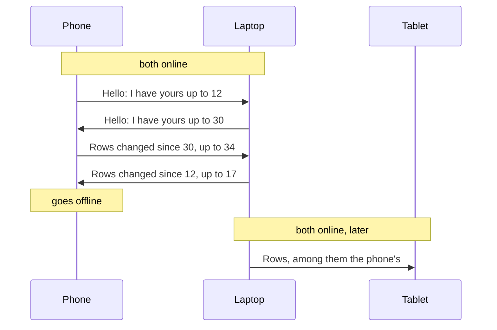
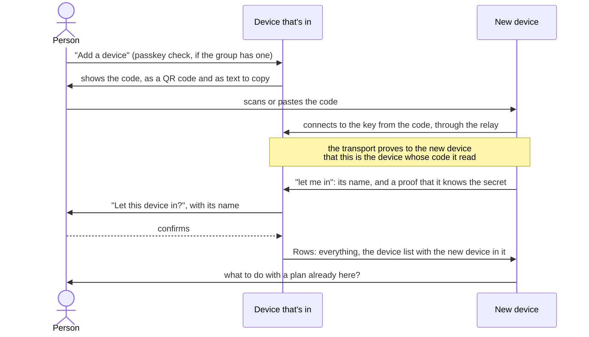

# Self-service: syncing between a person's devices

**Phase 2 of [Network](network.md), designed and not built yet.** How a person's devices sync with each other while they're online together, with nothing stored on a server. It is the base that [table service](network.md#self-service-and-table-service) is added to. How rows merge is in [Merging changes](merge.md). What the server's mailbox and an account add is in [The sync protocol](sync.md) and [Identity, sign-in and groups](identity.md). The work is [SantaClaas/week-budget-planner#105](https://github.com/SantaClaas/week-budget-planner/issues/105).

The cryptography here has not been reviewed, like the rest (see [What the cryptography is for](identity.md#what-the-cryptography-is-for) in [Identity, sign-in and groups](identity.md)).

## Decided

Rules about what the person gets, or choices that are the project's author's.

1. **A passkey is optional in self-service.** Without one, any device in the group can add or remove a device, and the device's own lock is the guard. With one, adding and removing need the passkey (see [Who may change the group](#who-may-change-the-group)).
2. **A device is added by scanning a QR code, or by pasting a long code.** There is no short code to type, since that would need a service that looks codes up (see [Adding a device](#adding-a-device)).
3. **A deletion marker is dropped once every device in the group has it.** A device that never comes back holds that up until it's removed from the group, which the app suggests (see [Deletion markers](#deletion-markers)).
4. **Self-service has no group key.** The connection between two devices is already encrypted between their keys. The group's secret arrives with table service, where a server stores things (see [What is encrypted, and by what](#what-is-encrypted-and-by-what)).
5. **There is no backup, and the app says so** (see [Losing a device, or all of them](#losing-a-device-or-all-of-them)).
6. **What a stolen device can do is accepted** (see [Who may change the group](#who-may-change-the-group)).

## The idea

**Every device holds all the rows, and whenever two of a person's devices are online together, each gives the other what it hasn't got.** A change made on the phone reaches the tablet through the laptop if the phone and the tablet are never online at once.

- **A device knows the others by their keys.** The group's devices are listed in the group's own data, which syncs like the plan. A device connects to each of the others by its key and lets in only the ones on the list.
- **The design doesn't care how two devices connect** (see [Self-service and table service](network.md#self-service-and-table-service) in [Network](network.md)). It asks the transport for a connection to a key. Today, in a browser, that connection always goes through the relay.
- **Nothing is stored anywhere but on the devices.** The relay passes bytes on and keeps none.

## The device list

**Who is in the group is written in the group's own data:** one row per device, merged like any other row (see [Registers](merge.md#registers) in [Merging changes](merge.md)).

| Register | Holds |
| --- | --- |
| identity | the relay it's reached through. Set when it's added, and never changed. The device's key, its id on the transport, is the row's id. |
| name | what the person calls it, at first what the browser says it is ("Firefox on Linux") |
| membership | in the group, removed, or temporary; and, where the group has a passkey, the proof that the person agreed (see [Who may change the group](#who-may-change-the-group)) |

- **A device only syncs with devices on its list.** A connection from any other key is refused.
- **No device is special.** Each can add another, and each holds everything.
- **The node id in a stamp stays its own short id** (see [Stamps and the clock](merge.md#stamps-and-the-clock) in [Merging changes](merge.md)). It isn't the device's key, and changes on an import.
- **The device's key** is the transport's (Ed25519, the iroh endpoint key), made on the device the first time syncing is turned on, kept outside the SQLite database and wrapped where it's stored (see [Keys](identity.md#keys) in [Identity, sign-in and groups](identity.md)). It is never in an export.

## What a device keeps for syncing

Beside its rows and its clock:

| It keeps | For |
| --- | --- |
| **a counter,** which goes up each time one of its rows changes, by its own action or by a merge | numbering its changes for the other devices |
| on each row, **the counter's value when the row last changed,** and which device that change came from | finding what another device hasn't got, without sending a change back where it came from |
| per other device, **how far it has that device's changes:** the other device's counter value up to which it has merged | telling the other where to continue |
| per other device, **how far that device has its own changes** | knowing when everyone has a deletion marker |

**There is no queue of unsent changes.** What one device owes another is every row that changed after the point the other says it has, as it is now.

- **The counter goes up once per write,** an action or a merge, and every row that write touched gets the same number. "Changed after a point" needs nothing finer.
- **A row merged from another device came from it** only when it came out as that device's version, every register the same. One that came out with registers from both sides is a version only this device has, so it counts as this device's own, and goes to everyone, the sender too.
- **Rows that were there before counting began** count as this device's change 1, so a device that has nothing of this one's (0) gets them.
- **In code:** the pure part is [`src/sync/origin.ts`](../../src/sync/origin.ts) (`noteAction`, `noteMerge`, `collectSince`); the device list's values are in [`src/device/index.ts`](../../src/device/index.ts) and its row in [`src/merge/row.ts`](../../src/merge/row.ts); the tables are in [Storage](merge.md#storage) in [Merging changes](merge.md).

A stamp wouldn't do for this. It says when a value was written. What a device has to send is what changed on it, in the order it changed there, and that includes rows it merged from a third device.

## The messages

Two devices speak over one connection of the transport, which has already proven each one's key. Both sides send the same messages. They are encoded as the server's are (see [The envelope](sync.md#the-envelope) in [The sync protocol](sync.md)), and a row travels whole, as in every change (see [The idea](merge.md#the-idea) in [Merging changes](merge.md)).

| Message | Holds | The other side |
| --- | --- | --- |
| `Hello` | the protocol's version, the group's id, the sender's own counter, and how far the sender has the receiver's changes | checks the version and that the sender is on its device list, then sends `Rows` from that point |
| `Rows` | rows, and the sender's counter value they bring the receiver up to | checks them strictly, merges them, notes how far it now has the sender's changes, and answers `Have` |
| `Have` | the counter value the sender now has the receiver's changes up to | notes it |
| `Refused` | why: not in the group, or a newer version is needed | see [When a device is refused](#when-a-device-is-refused) |

- **While two devices stay connected,** each sends `Rows` again whenever something changes on it.
- **A row isn't sent back to the device it came from.**
- **A device that says it has more of the other's changes than the other ever made** has outlived the other's data, for example after the other was restored from an old copy. The other then sends everything.
- **A new device has nothing,** so it gets everything: the first `Rows` it receives is a snapshot.
- **Nothing depends on order or on arriving once** (see [The idea](merge.md#the-idea) in [Merging changes](merge.md)). When a connection drops, the two say `Hello` again and continue.

### Finding each other

**A device tries to connect to every other device on its list:** when the app starts, when the network comes back, when the tab is looked at again, and every few minutes while it's open. A device that is online has its end open and answers. So no service has to know who is online, and the relay only does what it does for any connection.

- **The relay a device is reached through is in its row.** By default that's ours for every device (see [Self-service and table service](network.md#self-service-and-table-service) in [Network](network.md)).
- **The transport hangs when it's blocked,** so every attempt has a time limit, and "no other device is online" is something the app can say.
- **With a handful of devices, each connects to each.** Nothing needs a route.

### When a device is refused

| Why | The device |
| --- | --- |
| not in the group | It was removed. It turns syncing off, says so, and keeps its plan. |
| a newer version is needed | It stops syncing with that device and offers to reload, as when another tab runs a newer version. |

## What is encrypted, and by what

- **The transport encrypts each connection between the two devices' keys,** and each side knows the other's key from its device list. The relay in between can't read or change anything.
- **So self-service needs no key of the group's.** A group key is for what is stored where the group's devices aren't: the mailbox. It, the sealed copies and the key epochs arrive with table service (see [Encrypting changes and snapshots](identity.md#encrypting-changes-and-snapshots) in [Identity, sign-in and groups](identity.md)).
- **What a device stores stays as it is today:** in the browser's storage, protected by the device's own lock.

## Who may change the group

**Adding and removing a device are the two things that could lock a person out or let someone in.** Self-service has no server to check them, so the devices check them.

**Without a passkey,** any device in the group can add or remove another, and the guard is the device's own lock. Someone holding one of the person's devices unlocked can then do what the person can: remove the other devices, or add their own.

**With a passkey,** the group holds the passkey's record (its id and public key) in its own data, and from then on a change to a device's membership is only valid with the passkey's signature over it. Every device checks that itself, when it merges the change, without asking anyone.

- **How:** the device making the change asks the browser for the passkey with user verification. The challenge it signs is a hash of the change: the device's key, what happens to it, the group, and the stamp. The signature is stored in the membership register, so any device can check it at any time, also long after.
- **A change that needs a proof and has none is refused whole,** like anything else that fails the strict check (see [What is received is checked](merge.md#what-is-received-is-checked) in [Merging changes](merge.md)).
- **Turning this on is itself a change that any device in the group can make. Turning it off, or changing the passkeys, needs the passkey.** So the passkey protects from the moment it's set, not before: whoever holds an unlocked device of a group without one could set their own. That is one more reason to offer it when syncing is set up.
- **A passkey works without a server.** The browser makes it and signs with it for the app's address; checking a signature needs only the public key. The checking is done by a maintained library in the Rust module, not by code of our own. To check when it's built: that such a library accepts a challenge it didn't issue itself.
- **Why it's a choice:** a passkey prompt is one more thing to understand before two devices can sync, and some devices have no passkey that syncs to them. A person who wants only their phone and laptop in step may not want it. The app offers it when syncing is set up, and says what it guards against.

**The risk that's left is accepted.** A stolen, unlocked device can read and change the plan until it's removed, and in a group without a passkey it can change the group too. The person is presumably still in control of their other devices, which hold the whole plan: they remove the stolen one, and in the worst case leave the group and make a new one with the devices they have.

**What a stolen, unlocked device can still do, with a passkey on the group:** read the plan it has, and change it, until it's removed. It can't remove the others or add its own. Its stamps can be written to win every conflict, which nothing stops inside a group of one person's devices (see [Keys](identity.md#keys) in [Identity, sign-in and groups](identity.md)).

## Adding a device

**A device that's in shows a code, and the new device reads it.** The code holds what the new device needs to find the old one and to prove it read the code: the old device's key, its relay, and a secret of 128 random bits that works once, for ten minutes.

- **No server takes part,** beyond the relay passing bytes. The new device finds the old one by the key in the code, so nothing has to look anything up, and it works with any relay.
- **Nobody in between can step in.** The new device connects to the very key it read from the screen, and the transport proves the other end holds it. The secret proves to the old device that whoever connects read its screen.
- **The code is long:** about 80 letters and digits as text. It's scanned with the camera, after the app has asked (see [Browser permissions](security.md#browser-permissions) in [Security](security.md)), or copied and pasted, for example through the person's own notes. It is not for typing. A short code would need a service that turns it into a key, and self-service has none.
- **The old device shows the code and the new one reads it,** and not the other way round, for the reason given under [Adding a device](identity.md#adding-a-device) in [Identity, sign-in and groups](identity.md).
- **Someone who sees the code** and uses it within its ten minutes, before the person does, would be asking to join. So the old device shows what is asking and waits for the person to confirm, and the code works once.
- **A plan already on the new device:** an example week nobody kept, or an empty plan, is dropped. Otherwise the device asks whether to use the group's plan or to add this device's activities to it (see [Joining](sync.md#joining) in [The sync protocol](sync.md)).
- **Approved later** (see [Approved later, by a device that's in](identity.md#approved-later-by-a-device-thats-in) in [Identity, sign-in and groups](identity.md)) needs the two devices to meet through the relay anyway, so in self-service it saves nothing over the code. It belongs to table service, where the mailbox can hold the request.

## Removing a device

1. On a device that's in, the person picks the device in the list and removes it, with a passkey check if the group has one.
2. That device writes the removal into the device list.
3. Every device that merges it stops letting the removed device connect.
4. The removed device, the next time it reaches one of them, is told it's not in the group, turns syncing off and keeps its plan.

- **There's no key to renew,** since nothing is stored outside the devices.
- **What the removed device already has, it keeps.**
- **Until a device has heard of the removal, it still syncs with the removed one.** With a passkey on the group, that can change the plan but not the group. Without one, the removed device could, in that time, remove the others on a device that hasn't heard. That is the case the passkey closes.
- **A device that reappears after it was removed** joins again like a new one.

## Losing a device, or all of them

- **A lost device** is removed from another one. The plan is on every device that's left.
- **Every device lost, or the only one:** the plan is gone. Self-service keeps no copy anywhere else.
- **So the app says it plainly** when syncing is turned on, offers the export (see [Export, import and reset](persistence.md#export-import-and-reset-required) in [Persistence](persistence.md)), and reminds a person who has only one device in the group. A backup that needs no thought is what table service adds.

## Deletion markers

**A deletion marker is dropped once every device in the group has it.** A device knows that from what the others tell it: each says how far it has this device's changes, and a marker is a change with a number.

- **No clock is involved,** and no device ever brings a deleted row back: while any device could still hold the row unmarked, the marker stays.
- **A device that is gone holds it up.** Markers are then kept, which costs a little space and nothing else. The device list shows when each device last synced, and the app suggests removing one that hasn't for months. Once it's removed, it no longer counts.
- **Temporary devices never count.**
- **A device only knows what the others told it directly.** Where two devices are never online together and only meet through a third, each keeps the other's markers longer than it would need to. Passing on what one knows about a third is possible later, and isn't needed to be correct.
- **A removed device that joins again** comes as a new one, and "add this device's activities" then means what it says: rows it still has come back, also ones deleted since.

With the mailbox the same rule works better still: it knows how far each device has read, and tells each one (see [Dropping deletion markers](sync.md#dropping-deletion-markers) in [The sync protocol](sync.md)).

## The clock

**A device corrects its clock by the time of the server that serves the app.** Every response from the app's own address carries the time, and the app is loaded from there anyway, so nothing new is needed; it has to be a fresh response, not one the service worker answered from its cache (see [A clock that is wrong](merge.md#a-clock-that-is-wrong) in [Merging changes](merge.md)). Offline, it uses the last difference it knew.

## A window that keeps nothing

A window without the database, such as a private one, can join for as long as it's open (see [The limited storage levels](merge.md#the-limited-storage-levels) in [Merging changes](merge.md)):

- **It's added like any device,** by the code, and its row says it's temporary.
- **It doesn't count** for dropping deletion markers.
- **Its row is taken off the list** by any device that hasn't seen it for a day. It holds nothing the others don't have once it has synced, and what it hadn't sent when it closed is lost.

## What the relay learns

Self-service passes through nothing else of ours.

| It sees | Why | What reduces it |
| --- | --- | --- |
| each device's key and its IP address | it carries the connection | another relay (see [Self-service and table service](network.md#self-service-and-table-service) in [Network](network.md)) |
| which devices connect to which, so which devices belong together | every packet names the device it's for | nothing here |
| when a person's devices are online, and when something changes | the connections and their traffic | nothing here |
| roughly how much changed | the size of what passes | padding, as for the mailbox |

It doesn't learn who the person is, what the plan holds, or anything of it. It has no account to tie the devices to.

## What the person does

Only the steps; the screens are [SantaClaas/week-budget-planner#99](https://github.com/SantaClaas/week-budget-planner/issues/99).

- **Turning syncing on:** read what it does and what passes through a relay; choose whether to guard the group with a passkey; then add a device.
- **Adding a device:** on a device that's in, "Add a device"; scan or paste the code on the new one; confirm on the first what is asking; on the new one, choose what happens to a plan already there.
- **Removing a device:** pick it in the list; pass the passkey check if the group has one.
- **Afterwards nothing:** the devices sync when they're online together, and the status says whether another device is reachable.

## Tests

**Each device's side of the protocol is a pure state machine** (see [The two state machines](sync.md#the-two-state-machines) in [The sync protocol](sync.md)): messages, time and "something changed here" in; messages, rows to merge and things to store out. The simulation builds on the merge's (see [Tests](merge.md#tests) in [Merging changes](merge.md)):

- **Several devices that are never all online together,** connections that drop at every point, and devices that are added, removed and restored from an old copy, with a seeded scheduler.
- **What must hold:**
  - a change made on one device reaches every device that stays in the group and is ever online with one that has it;
  - devices that have exchanged everything show the same plan;
  - a deleted row never comes back, whenever markers are dropped;
  - a removed device gets nothing new from a device that has heard of the removal;
  - with a passkey on the group, a membership change without its proof changes no device's list.
- **The proof's checks,** with what they accept and each thing they refuse.

## Terms

Technical terms, for code and docs (see [Terms](network.md#terms) in [Network](network.md)):

| Term | Meaning |
| --- | --- |
| **Device list** | The group's devices, as rows in the group's own data. |
| **Counter** | A device's count of changes to its rows, by its own actions and by merges. It numbers what other devices have to fetch. |
| **Proof** | A passkey's signature over a change to the device list, kept with the change so any device can check it. |
