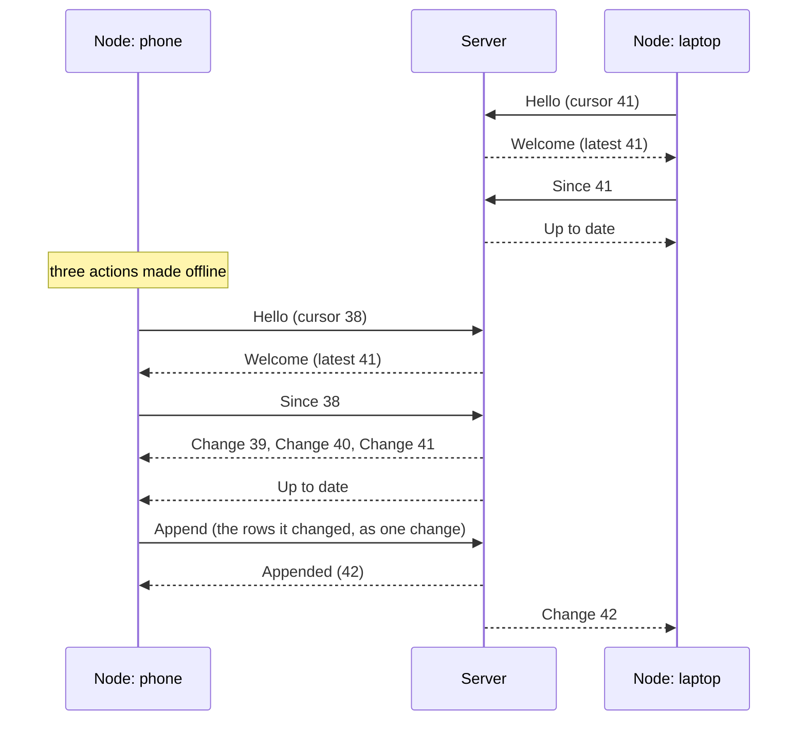

# The sync protocol

**Phase 3 of [Network](network.md), table service, designed and not built yet.** What the server's mailbox adds to [self-service](self-service.md), where a person's devices sync with each other: it keeps changes for devices that are offline, and holds a backup. How rows merge is in [Merging changes](merge.md), and accounts and the group's key are in [Identity, sign-in and groups](identity.md). This file takes "a device that is in a group, with an account and the group's key" as given. The work was [SantaClaas/week-budget-planner#90](https://github.com/SantaClaas/week-budget-planner/issues/90), reshaped by [SantaClaas/week-budget-planner#105](https://github.com/SantaClaas/week-budget-planner/issues/105).

## Decided

These are rules about what the user gets, or numbers that are the project's author's to set.

1. **A device that joins a group with a plan of its own asks what to do with it:** replace it with the group's, or add its activities to the group's (see [Joining](#joining)). An example week nobody kept, or an empty plan, is dropped without asking.
2. **While syncing is on, an import changes the plan on every device** (see [Importing while syncing](#importing-while-syncing)).
3. **A deletion marker is dropped once every device in the group has it,** as in self-service. The mailbox knows how far each device has read, and says so (see [Dropping deletion markers](#dropping-deletion-markers)).
4. **The server keeps a group's data for 13 months after its last connection** (see [Leases](#leases)).
5. **A group may hold 5 MB on the server** (see [Snapshots and the storage limit](#snapshots-and-the-storage-limit)).

## The idea

**The devices hold the truth, and the server is a mailbox.** Every device has all the rows. The server keeps what one device wrote until the others have read it, and can't read it itself. If the server loses everything, the next device to connect puts it all back.

The merge is what makes the protocol small. A change can be merged in any order and any number of times (see [The idea](merge.md#the-idea) in [Merging changes](merge.md)), so the protocol never has to deliver exactly once or in order. It only has to make sure every change reaches every member at some point.

- **The log:** per group, the server numbers each change it receives, from 1 up. That number is the change's **sequence number**.
- **The cursor:** each node remembers the highest sequence number up to which it has merged everything.
- **The snapshot:** all of a node's rows, uploaded so the server can drop the changes before it.

It is the shape of a video stream: a snapshot is a keyframe, a whole picture that needs nothing before it, and changes are the frames in between that only say what's different. A new viewer starts at a keyframe, and a keyframe now and then keeps the stream short. One thing is easier here than in video: a change doesn't build on the one before it, so a missing or repeated one spoils nothing.

## What each side keeps

**The server, per group:**

| It keeps | For |
| --- | --- |
| the group's id and its member nodes | refusing everyone else (see the identity design) |
| the log: each change's sequence number, encrypted bytes, key epoch, sender and the time it arrived | handing out what a node hasn't read |
| at most one snapshot: its encrypted bytes, key epoch, and the sequence number it covers | letting the log's start be dropped |
| the bytes it holds for the group, and the limit | the storage limit |
| when a member last connected | deleting a group nobody uses any more |

**A node,** in the `node` table beside its id and clock (see [Storage](merge.md#storage) in [Merging changes](merge.md)), so it survives a reload and a new leader tab:

| It keeps | For |
| --- | --- |
| the group's id | knowing it syncs, and with whom |
| the cursor | asking for what's new |
| how far the mailbox has this device's changes: the value of the device's counter up to which the mailbox has acknowledged them (see [What a device keeps for syncing](self-service.md#what-a-device-keeps-for-syncing) in [Self-service](self-service.md)) | knowing what it still has to send |
| the lowest cursor among the group's devices, as the mailbox last said it | knowing which deletion markers every device has |
| how far its clock is off the server's | correcting its stamps (see [The clock](#the-clock)) |

**There is no queue of unsent changes.** What a device owes the mailbox is every row that changed on it after the point the mailbox has acknowledged, except rows whose last change came from the mailbox itself. That includes rows it merged from another device directly, which the mailbox may not have yet. It sends those rows as one change, however many actions made them. A week of changes made offline goes up as one message with each touched row as it is now.

A deleted row also keeps the sequence number its marker got in the log (see [Dropping deletion markers](#dropping-deletion-markers)).

## The messages

A connection is one stream of the transport (see Transport under [Phase 3](network.md#phase-3-table-service-the-server) in [Network](network.md)), which is ordered and reliable and has already proven each side's node id. The protocol doesn't know more about it than that, so the same messages work over a WebSocket.

| Message | From | Holds | The other side |
| --- | --- | --- | --- |
| **Hello** | node | the protocol version, the group, the cursor, whether it's temporary | answers Welcome or Refused |
| **Welcome** | server | the server's time, the log's latest sequence number, the sequence number the snapshot covers, the bytes held and the limit, the date the group is kept until | the node asks for what's new and sends what it has |
| **Refused** | server | why: not a member, a newer version is needed, the storage is full, a newer snapshot exists, the message is too big | see [What a node does when refused](#what-a-node-does-when-refused) |
| **Append** | node | an id for this message, the key epoch, an encrypted change | the server gives it the next sequence number, stores it, answers Appended, and sends it to the group's other connected nodes |
| **Appended** | server | the message's id, its sequence number, the time it arrived, the bytes held | the node notes that the mailbox has its changes up to there |
| **Since** | node | a cursor | the server sends the snapshot first if the cursor is before what it covers, then every change after, then Up to date, and from then on each new change as it arrives |
| **Change** | server | the sequence number, the key epoch, the sender, the time it arrived, the encrypted change | the node decrypts, checks and merges it, and moves its cursor on |
| **Snapshot** | server | the sequence number it covers, the key epoch, the encrypted snapshot | the node merges it and sets its cursor to what it covers |
| **Up to date** | server | the log's latest sequence number, the lowest cursor among the group's devices, the server's time | the node notes the lowest cursor (see [Dropping deletion markers](#dropping-deletion-markers)) |
| **Put snapshot** | node | the sequence number it covers, the key epoch, an encrypted snapshot | the server stores it, drops the changes up to that number and the older snapshot, and answers Snapshot stored |
| **Snapshot stored** | server | the sequence number it covers, the bytes held | |

- **A node's own change doesn't come back to it.** Appended carries its sequence number, and the node counts it as merged.
- **The cursor only moves over a gap-free run.** A node that has 39 and 41 but not 40 keeps its cursor at 39.
- **An Append that got no answer is sent again with the same id.** The server answers with the sequence number it already gave it, so a dropped connection doesn't store a change twice. Stored twice would still merge correctly; it would only waste space.
- **A message has a size limit** of 1 MB. A plan's snapshot is tens of kilobytes, most of it deletion markers.

## The envelope

**In the clear, for the server:** the kind of message, the group (once, in Hello), the key epoch, the message's id, and the numbers above. That is what the server needs to route and store.

**Encrypted, for the group:** the change or snapshot of [Merging changes](merge.md), with its own format version first, in the encoding below, padded.

- **Bound into the encryption:** the protocol version, the group, the key epoch, and whether it's a change or a snapshot. A message taken from one group, epoch or kind doesn't decrypt as another. The cipher and the keys are the identity design's.
- **Padding:** the content is padded to the next of a few fixed sizes before it's encrypted, so the server sees roughly how much changed and not exactly.
- **Versions:** Hello carries the protocol's version, and the server refuses one it doesn't speak, naming what's needed. A change whose inner format is newer than the node knows stops that node's merging until the app is updated (see [What is received is checked](merge.md#what-is-received-is-checked) in [Merging changes](merge.md)).
- **Everything is encoded as [postcard](https://postcard.jamesmunns.com/wire-format)'s wire format,** the messages and what's encrypted inside them: a binary encoding that doesn't describe itself. Fields come in a fixed order with no names, whole numbers take as few bytes as they need, and bytes and text carry their length. Both sides have to know the layout, which is written down here field by field when the protocol is built.
  - **Why not JSON.** A snapshot carries every deletion marker that some device may not have yet, and a row has up to six stamps of 33 characters, so as text a snapshot is mostly the same stamps again and again: several hundred kilobytes for someone who rearranges often.
  - **Why not a format that describes itself or tolerates the unknown** (CBOR, MessagePack, Protocol Buffers): they spend bytes on it, and a node here must never merge what it can't read all of (see [What is received is checked](merge.md#what-is-received-is-checked) in [Merging changes](merge.md)). A new format version is a new layout, and an older app refuses it. Protocol Buffers would keep fields it doesn't know without a word, which is the opposite.
  - **Stamps aren't repeated.** One action gives everything it writes the same stamp. A change or snapshot starts with a table of the node ids and the stamps it uses, and each register refers to its stamp by number. A stamp then costs about 13 bytes once, and a byte or two wherever it's used again.
  - **No compression on top.** With this encoding and messages this small it would save little, and compressing before encrypting lets sizes say more than they should.
  - **One codec, in the Rust module:** it encodes and decodes, and hands the app plain values, which the merge still checks strictly. A native app later uses the same code. The server needs only the messages' outer fields.
  - **Test vectors** keep every implementation the same: a file of messages with their exact bytes, which each side's tests encode and decode.
  - **What the merge compares stays as it is:** equal stamps with different values are decided by the values as canonical JSON (see [Stamps and the clock](merge.md#stamps-and-the-clock) in [Merging changes](merge.md)). That is a rule about values, not about bytes on the wire.
  - To check when it's built: the version of postcard's format, which is pinned, and that its specification covers every type used.

## Snapshots and the storage limit

**The server refuses an Append that would take a group over its limit,** and every Welcome and Appended says how much is held. A node makes room by putting a snapshot:

1. It is up to date: its cursor is the log's latest sequence number.
2. It sends all its rows, with "covers" set to that number. Its own unsent rows are in there too, which is fine: they'd be sent next anyway.
3. The server stores the snapshot and drops every change up to that number. The node notes that the mailbox has all its changes, since the snapshot held its unsent rows.

- **A node puts a snapshot** when the bytes held pass half the limit, or when its Append is refused for space. So the limit is what makes devices tidy up, and in normal use the log never grows long.
- **Two nodes at once:** the server keeps the snapshot that covers more and refuses the other as outdated. Equal ones: the first wins. Nothing is lost either way, since a refused snapshot's rows are still in its node.
- **A node that hadn't read the dropped changes** asks Since with an older cursor and gets the snapshot, which holds everything they did. Merging a snapshot is the same merge.
- **The server can't check a snapshot.** It trusts that a member's snapshot holds what it says it covers. A member is one of the person's own devices, and a broken one could do as much harm with a change.
- **Temporary nodes don't put snapshots** unless nothing else can make room, so what gets dropped is decided by a device that keeps its rows.

## Order and loss

What the protocol guarantees, and all the merge needs:

- **Every change the server acknowledged stays** until a snapshot that covers it replaces it.
- **A node that asks from its cursor gets everything after it,** as changes or as a snapshot.
- **A node sends everything that changed on it after what the mailbox has acknowledged,** again after every reconnect, until it's acknowledged.

Nothing depends on order, and receiving something twice is harmless. When a connection drops in the middle of anything, the node reconnects, says Hello with the cursor it has, and carries on.

**If the server has lost data,** for example after it was restored from a backup, its latest sequence number in Welcome is below the node's cursor. The node then puts a snapshot of everything it has and continues from there. The same happens when the server no longer knows the group's data at all.

## What a node does when refused

| Why | The node |
| --- | --- |
| not a member | turns syncing off on this device and says so; it keeps its plan (the screens are their own issue) |
| a newer version is needed | stops syncing and offers to reload, as when another tab runs a newer version |
| the storage is full | puts a snapshot, then tries again |
| a newer snapshot exists | drops its own attempt |
| the message is too big | says that syncing failed; it should never happen with a plan |

## Joining

**Turning table service on** for a group that syncs by self-service: one device makes the group's first secret, gives it to the others (see [Adding a device](identity.md#adding-a-device) in [Identity, sign-in and groups](identity.md)), and puts a snapshot. A group of one device does the same without the handing over.

**Joining one** with a second device, which has a plan of its own from its first run or from before:

- **An example week nobody kept, or an empty plan, is dropped,** and the device takes the group's. Nobody chose those rows.
- **Otherwise the device asks,** before it sends anything:
  - **"Use the synced week":** this device's rows are dropped and replaced by the group's. The dialog offers an export first.
  - **"Add this device's activities":** its rows merge into the group's. With ids that are never shared (see [The example week](merge.md#the-example-week) in [Merging changes](merge.md)), that gives all activities and blocks of both, and the person removes what's double.
- **Leaving a group,** by turning syncing off, keeps the plan on the device and stops there.

## Importing while syncing

**An import on a syncing device is an action like any other:** the plan before, the file's plan after, with a new stamp, sent to every device (see [Export and import](merge.md#export-and-import) in [Merging changes](merge.md)). Replacing only this device's rows wouldn't hold: the next sync would merge the group's rows back in, and the result would be neither the file nor the group's plan. The import dialog says that every device gets the imported plan. A person who wants the file on one device only turns syncing off there first.

## Temporary nodes

A window that keeps nothing says so in Hello (see [Removing a device](network.md#removing-a-device) in [Network](network.md)).

- **Its lease is short:** it stays on the member list for an hour after its last message, and is renewed by being connected.
- **It starts with no cursor,** so it gets the snapshot and what follows, every time.
- **Its unsent changes are lost if it closes while offline.** The save status has to say when something isn't sent yet.

## Dropping deletion markers

**A marker is dropped once every device in the group has it,** as in self-service (see [Deletion markers](self-service.md#deletion-markers) in [Self-service](self-service.md)). With the mailbox, a device learns that sooner and for devices it never meets:

- **The mailbox knows how far each device has read:** its cursor. In Up to date it gives the lowest cursor among the group's devices that aren't temporary.
- **A marker has a sequence number,** the one its change got in the log, which Appended and Change carry. Once the lowest cursor has passed it, every device has it, and any device may drop it.
- **A snapshot leaves out the markers that may be dropped,** so it stops growing with every deletion.
- **No clock is involved, and nothing brings a deleted row back:** while one device could still hold the row unmarked, the marker stays.
- **A device that is gone holds it up,** until it's removed from the group. The device list shows when each device last synced, and the app suggests removing one that hasn't for months.
- **A device that only syncs with other devices and never with the mailbox** counts through what those devices know of it (see [Deletion markers](self-service.md#deletion-markers) in [Self-service](self-service.md)). A marker goes when either way says every device has it.

## Leases

- **A group's data:** the server keeps it for 13 months after a member last connected, and Welcome says until when. Deleted data loses nothing while a device still has the plan: the next one to connect finds the server empty and puts a snapshot. The app warns when the date is near and the device is the only one left.
- **A temporary node's membership:** an hour, as above.
- **A signed-in session:** the identity design's.

## The clock

A device corrects its clock by the time of the server that serves the app, as in self-service (see [The clock](self-service.md#the-clock) in [Self-service](self-service.md)). Welcome and Up to date carry the server's time too, which serves the same. The time a message took to arrive is ignored: it's a second at most, and stamps only have to order what people do.

## What the server learns

Added to the table in [Network](network.md):

| It sees | From | What reduces it |
| --- | --- | --- |
| when each node connects, and for how long | the connection | not solved here |
| when a person changes something, and on which device | each Append, with its sender | a node could send on a timer instead of at once; not done, since changes should arrive quickly |
| roughly how much changed | the size of each change | padding to fixed sizes |
| how far behind each device is | the cursor in Hello and Since | nothing: it's needed to hand out the right changes |
| that a node is temporary | Hello | nothing: it enforces the short lease |
| when a group's rows were tidied | Put snapshot | nothing |

It doesn't learn what changed, how many activities or blocks there are, or anything in them.

## What the identity design adds

[Identity, sign-in and groups](identity.md) says why. These travel on the same connection, with the same envelope:

| Message | From | Holds | The other side |
| --- | --- | --- | --- |
| **Put sealed secrets** | a member | a key epoch, and that epoch's secret sealed once per device, for the recovery key and for the passkey key | the server stores them and refuses an epoch that isn't newer than the latest |
| **Sealed secret** | server | a key epoch and the copy sealed for this node | sent after Welcome when the node's latest epoch is older; the node opens it |
| **Remove node** | a member | the node to remove, and a passkey's answer to a fresh challenge | the server checks the answer, refuses that node from then on, and tells the group's connected members |
| **Ask to join** | a node that has the passkey and isn't in the group | its keys, signed for by the passkey (see [Approved later](identity.md#approved-later-by-a-device-thats-in) in [Identity, sign-in and groups](identity.md)) | the server keeps the request for a few days and hands it to the group's members |
| **Answer to join** | a member | the request it answers, and the epoch secret sealed to the new node | the server puts the node on its member list and passes the rest on |

- **Adding a device with a code needs none of these.** It happens between the two devices (see [Adding a device](self-service.md#adding-a-device) in [Self-service](self-service.md)). The device that's in then tells the server the new node belongs to the group, with Answer to join.
- **A new epoch starts with a snapshot.** After Put sealed secrets, the same member puts a snapshot under the new epoch. From then on the server refuses an Append under an older epoch, and drops what it held under it.
- **A node that reads an epoch it has no secret for** asks for its sealed secret and waits. If none exists for it, it was removed.
- **The server stores** the sealed secrets, per group, epoch and recipient. They are opaque to it.
- **It learns** when a device is added and removed, and that a new epoch began.

## The two state machines

**Each side of the protocol is a pure state machine:** it takes what happened (a message, the time passing, a connection opening or closing; for the node also "an action was saved", for the server also "a member was removed") and returns what to do (messages to send, changes to merge, rows to store). The transport, the database and the clock are at the edges (see [A pure core, with side effects at the edges](../guidelines/principles.md#a-pure-core-with-side-effects-at-the-edges) in [`docs/guidelines/principles.md`](../guidelines/principles.md)).

- **The node's** is TypeScript, beside the merge. **The server's** is Rust.
- **Simulation** runs several nodes and the server's machine in one process, with a seeded scheduler over the messages (see [Testing](network.md#testing) in [Network](network.md)). The node's tests use a small model of the server written in TypeScript, and the server's tests use scripted nodes. The shared test vectors keep the bytes the same, and an end-to-end test in a browser against the real server checks the two together.
- **What the simulation must show:** all nodes that have synced show the same plan; nothing a node saved is lost, also when connections drop at every possible point; a removed node gets nothing new; the limit holds; a server that restarts or loses data is filled again; and no deleted row comes back, whenever markers are dropped.

## Terms

Technical terms, for code and docs (see [Terms](network.md#terms) in [Network](network.md)):

| Term | Meaning |
| --- | --- |
| **Log** | A group's changes on the server, in the order they arrived. |
| **Sequence number** | A change's place in the log, counted from 1. |
| **Cursor** | The highest sequence number up to which a node has merged everything. |
| **Lowest cursor** | The lowest cursor among a group's devices that aren't temporary. Everything in the log up to it has reached every device. |
| **Temporary node** | A node that keeps nothing, such as a private window, and is let go when it closes. |
