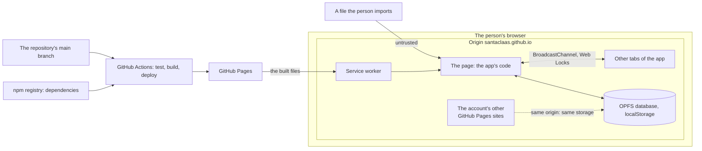

---
paths:
  - "index.html"
  - "package.json"
  - "pnpm-workspace.yaml"
  - "public/**"
  - "vite.config.ts"
  - "vite-plugins/**"
  - "src/database/client.ts"
  - "src/storage/**"
  - ".github/workflows/**"
---

# Threat model

What the app protects, from whom, how, and where the protection has gaps. [Security](security.md) says what the rules are; this file says what each rule is for, so a change can tell whether it weakens one, and a gap is written down rather than forgotten.

It covers the app as it's built and hosted today: a static site on GitHub Pages with no backend, the plan stored in the browser. Syncing between devices is designed and not built, and its design keeps its own threat model, which this file doesn't repeat: [What the server learns](network.md#what-the-server-learns) in [Network](network.md), [What the cryptography is for](identity.md#what-the-cryptography-is-for) in [Identity, sign-in and groups](identity.md), and [What the server learns](sync.md#what-the-server-learns) in [The sync protocol](sync.md).

This model was written from the spec and the code, not by a security reviewer, and it hasn't been reviewed. Like the cryptography in [Identity, sign-in and groups](identity.md), it doesn't claim more than that.

## What is protected

- **The plan.** Activity names, budgets and blocks say when a person works, studies, trains or sleeps, every week. It must stay readable only to them (confidentiality), stay as they made it (integrity), and still be there tomorrow (availability).
- **The app's code as it reaches the browser.** Whatever code runs on the page can read and change the plan, so every protection of the plan depends on the code being the code in this repository.
- **The repository and its deploy.** They decide what code reaches the browser.

The settings (theme, contrast, day hours) are kept the same way as the plan and say little about a person, so they need nothing of their own.

## Where the boundaries are

Everything inside the origin trusts everything else inside it: the browser gives every page there the same storage and lets it talk to the app's tabs. What crosses into the origin from outside is checked: an imported file, the code that the deploy puts on GitHub Pages, and through the build, the dependencies.

## Threats, and what stands against them

Each threat names what it would cost, what protects against it today, and the gap, if there is one. Where a protection is a rule in another file, the link goes there.

### Script that isn't the app's runs on the page

**What it would cost:** everything. Script on the page reads and changes the plan, and could send it anywhere the policy allows.

**What protects against it:**

- **User text is shown as text**, never as HTML (see [Security](security.md)): JSX children and `textContent`, so an activity name that looks like markup stays a name.
- **Trusted Types** refuse every string written as HTML or code, unless the build put the exact string on an allowlist of Solid's own templates. A mistake in our own code, such as `innerHTML` with an activity name, fails instead of running.
- **The Content Security Policy** only runs scripts from the app's own origin and the two inline scripts whose hashes the build computed, allows no `eval`, and lets the page load nothing from other origins (`default-src 'self'`). Cross-origin isolation (`require-corp`) refuses cross-origin files on top.
- **A browser test** ([`e2e/security.spec.ts`](../../e2e/security.spec.ts)) checks that `innerHTML`, `insertAdjacentHTML`, `eval` and a cross-origin worker are refused.

**Gaps, accepted:** styles allow `'unsafe-inline'`, since Solid's templates and the icon sprite set `style` attributes; with no way to write HTML, there is no way to inject a `style` either. emnapi's one expected Trusted Types violation per page load is known and named in [Security](security.md); any other is a bug.

### A crafted file is imported

Someone sends a person a file and asks them to import it, or a file is simply broken.

**What it would cost:** the plan in this browser, which an import replaces, and what is done with it afterwards.

**What protects against it** (see [Export, import and reset](persistence.md#export-import-and-reset-required) in [Persistence](persistence.md)):

- A `.db` file must start with the SQLite header, and a copy of it is opened, migrated and read before anything is replaced. A file that fails any step changes nothing.
- A file from a newer version is refused, never read as this version's.
- A `.json` file must be a plan in the stored format.
- Every plan that is loaded, from storage or an import, goes through `sanitizePlan`, which repairs what's out of range and drops what doesn't belong (see [Data model](data-model.md)). The plan on screen is therefore always valid, whatever the file held.
- The person confirms first, in a dialog that names the file and what it replaces, with a link to export the current plan.

**Gap, open ([SantaClaas/week-budget-planner#124](https://github.com/SantaClaas/week-budget-planner/issues/124)):** an imported `.db` file is kept byte for byte once its copy reads, so everything in its schema comes with it, not just its rows. A crafted file can hold tables without the `CHECK` constraints or `STRICT` that the migrations create while listing those migrations as applied, and it can hold triggers. The database engine runs triggers (checked with `@tursodatabase/database` on 2026-11-20), so a trigger in the file would run on the app's own later writes, for example deleting every block whenever an activity is saved. SQL has no way to reach the network, so it can't send the plan anywhere, but it can damage the plan from then on, travel on in every export, and with syncing, shape the changes this browser sends; the other devices check those strictly and refuse what's invalid (see [What is received is checked](merge.md#what-is-received-is-checked) in [Merging changes](merge.md)). Done looks like either of these, with a test using a file that has a trigger and a table without its constraints:

- compare the copy's schema (`sqlite_schema`) with the one the migrations make, and refuse the file if it holds anything else; or
- build a new database with the migrations and write the plan read from the copy into it, so no byte of the file's schema is kept.

### The account's other GitHub Pages sites share the origin

GitHub Pages serves every project site of an account from one origin, `santaclaas.github.io`, with each project under its own path.

**What it would cost:** the plan's confidentiality and integrity. The browser separates storage by origin, not by path, so any page on another of the account's Pages sites can read and write the app's OPFS database and `localStorage`, take the Web Lock, and send messages to the app's tabs over BroadcastChannel. A service worker registered at the origin's root would control the app's pages until the app's own worker, whose scope is narrower, is installed.

**What protects against it:** every site on the origin is the project's author's own. The prefix on storage keys (see Storage keys in [`docs/guidelines/typescript.md`](../guidelines/typescript.md)) only prevents collisions; it protects nothing.

**Gap, open ([SantaClaas/week-budget-planner#125](https://github.com/SantaClaas/week-budget-planner/issues/125)):** the app trusts every page the account ever publishes on GitHub Pages. Until the app moves, that means never publishing a Pages site under this account that runs code from others or shows HTML it didn't write. The fix is an origin of the app's own: a custom domain, or the sync server's origin, which is already decided ([Hosting](network.md#hosting) in [Network](network.md), and decision record [0005](../decisions/0005-github-pages-with-a-service-worker.md)).

### The page is framed by another site

Another site loads the app in a frame and tricks a person into clicking, for example on Delete all data.

**What protects against it:** `frame-ancestors 'none'`, which the service worker adds as a header, since a `<meta>` policy can't carry it (see [Security](security.md)). Delete all data and an import both ask for confirmation in a dialog first.

**Gap, accepted:** on GitHub Pages the header only exists once the service worker controls the page: on a first visit, before the reload, and in a browser with service workers blocked, the page can be framed. The confirmation dialogs make that hard to use, and on the app's own origin (see above) the headers come from the server.

### A dependency is compromised

A package the app or its build depends on publishes a malicious version.

**What it would cost:** everything, like script on the page. Code from a runtime dependency is bundled into the app; code from a build dependency (Vite, its plugins, the compilers) runs during the build and can change what the build writes.

**What protects against it** (see [`pnpm-workspace.yaml`](../../pnpm-workspace.yaml)):

- **A week's wait:** a version installs only once it's a week old, transitive dependencies included, checked on every install, so a bad release has time to be found and pulled. Exceptions name the exact version and say why.
- **Trust can't drop** between releases of a package (`trustPolicy: no-downgrade`), and no dependency may come from outside the registry (`blockExoticSubdeps`).
- **Install scripts** only run for listed packages (`strictDepBuilds`, `allowBuilds`).
- **Exact versions and a frozen lockfile** in CI, so what was tested is what's built.
- **Few dependencies,** and knip ([`knip.jsonc`](../../knip.jsonc)) finds the unused ones, so they can go.

**Gap, accepted:** a malicious version that stays unnoticed for a week still gets in, and dependencies aren't read before they're updated. Pinned versions and the lockfile mean it takes a deliberate update for one to arrive.

### The deploy pipeline is compromised

**What it would cost:** everything: whatever the deploy puts on GitHub Pages is the app.

**What protects against it** (see [`docs/guidelines/workflows.md`](../guidelines/workflows.md)):

- Every action is pinned to a commit hash, and Dependabot proposes updates only a week after a release.
- The workflows grant no permissions by default, each job only the ones it needs, and the checkout keeps no credentials. Only the deploy job can publish, through the `github-pages` environment, and it never runs for a pull request.
- CI lints the workflows with actionlint and zizmor.

**Gap, open question:** who can push to `main`, and how the account that can is protected (two-factor authentication, branch protection, required checks), lives in GitHub's settings and isn't recorded here. A push to `main` deploys.

### A newer or older tab of the app writes the plan

Not an attack, but the way the plan is most likely to be damaged: two versions of the app open at once after an update.

**What protects against it:** each thing the tabs share carries a version, and an outdated tab steps down, turns read-only and reloads (see [Tabs on different versions](persistence.md#tabs-on-different-versions) in [Persistence](persistence.md)). One tab at a time holds the database (see [Calls between tabs](persistence.md#calls-between-tabs)).

### The plan is lost

**What it would cost:** the plan's availability, the most likely loss of all.

**What protects against it:**

- **The browser's own clearing:** the app asks the person, in its own words, whether the browser should keep the plan, and only then asks the browser for persistent storage (see [Keeping the data](persistence.md#keeping-the-data) in [Persistence](persistence.md)).
- **Export:** the whole database as a file, offered wherever keeping the plan is in doubt.
- **A database that won't open** isn't hidden: the app falls back to limited storage and says so (see [Export, import and reset](persistence.md#export-import-and-reset-required)).
- **Bugs:** every path that could lose the plan has a browser test (see [`docs/guidelines/tests.md`](../guidelines/tests.md)).

**Gap, accepted:** in a private window or a browser that blocks storage, the plan lives only as long as the window, and the app says so (see [Progressive enhancement](persistence.md#progressive-enhancement)).

### The person is tracked

**What protects against it:** the app makes no requests to other origins (the transport, when something starts it, connects only to the relay on the app's own origin), has no analytics and no account, sends `Referrer-Policy: strict-origin-when-cross-origin`, and turns off camera, microphone and location (`Permissions-Policy`). It never prompts for a browser permission without explaining it first (see [Browser permissions](security.md#browser-permissions) in [Security](security.md)). GitHub, as the host, sees requests for the app's files, as any host would.

## Out of scope

- **Someone with the unlocked device or the browser profile.** The plan isn't encrypted on the device, in OPFS or `localStorage`. Protecting a device and its browser profile is the operating system's and the browser's job, and anyone with them could also run the app.
- **Browser extensions with access to the site.** They can read and change any page they're allowed on. That is the person's choice to make, in their browser.
- **A compromised browser or operating system.**

## Keeping this file honest

Update it in the same change that adds something it describes: a new kind of input (a file format, a URL parameter, a message), a new place the plan is stored, a request to anywhere, a browser permission, a new kind of dependency or a new workflow. A gap marked open has an issue, linked beside it, and leaves this file only when it's fixed, with a link to what fixed it.
